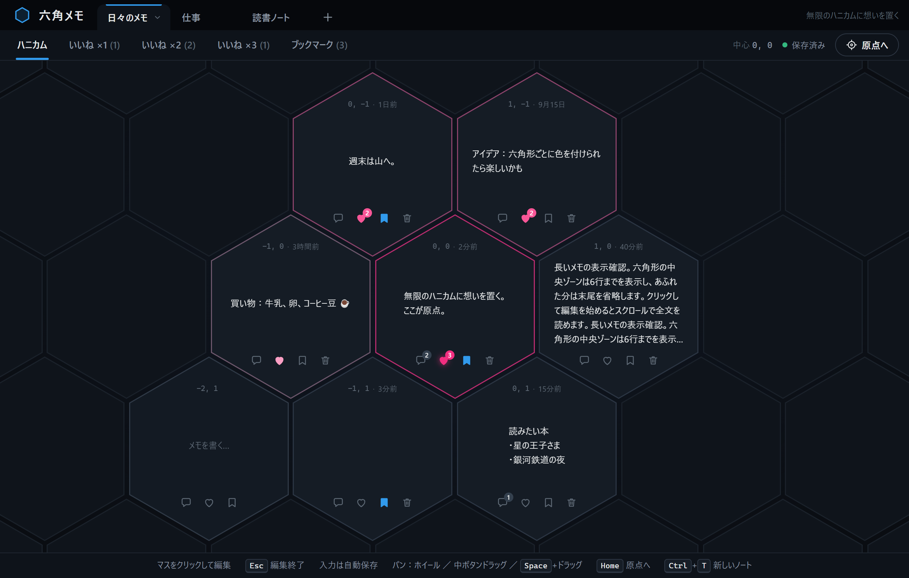
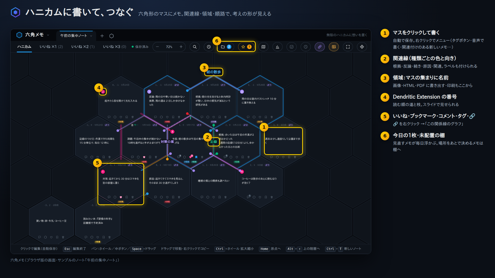
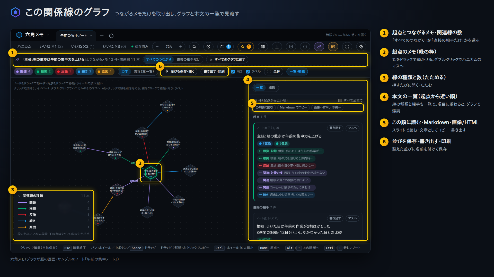
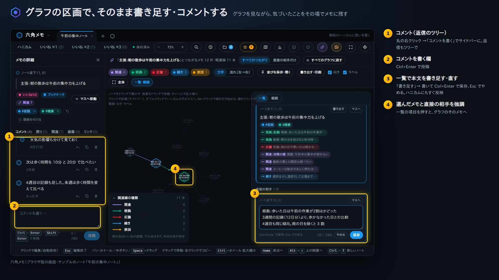
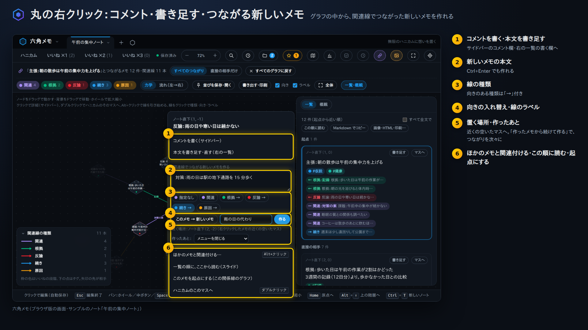
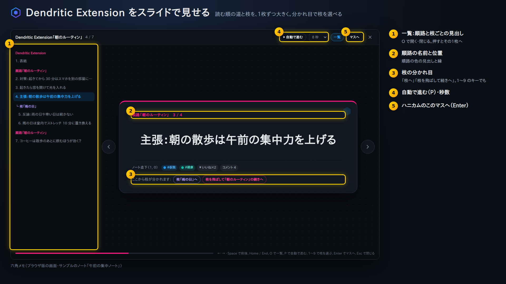
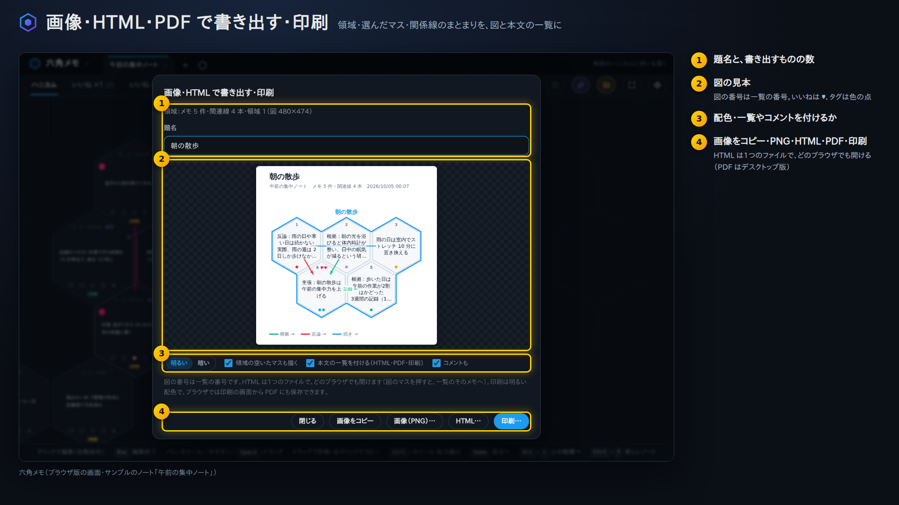

# 六角メモ（hex-memo）

**無限のハニカムに想いを置く** — 六角形のマスを X（旧 Twitter）の1ポストに見立てて、短い文章を書き、いいね・ブックマーク・コメントできるデスクトップメモアプリです。上段のタブで「ノート」を切り替えると、ノートごとに別のハニカムを使えます。データはすべてローカルに保存されます。



### 画面イメージ（番号は右の説明に対応）

| | |
|---|---|
|  |  |
|  |  |
|  |  |

デモ動画（関係線のグラフ／ひとめぐり）は `npm run demo:graph`・`npm run demo:tour` で作れます（→「デモ動画・画面イメージの作り方」）。

## 動作環境

- Windows / macOS / Linux
- Node.js 18 以上（npm 同梱）
- Electron 33（`npm install` で自動取得。依存パッケージはこれだけです）

## 起動方法

### Windows：ダブルクリックで起動

フォルダの中の **`六角メモ.cmd`** をダブルクリックします。

- 黒いウィンドウが一瞬表示されてすぐ閉じ、アプリが開きます。
- 初回（`node_modules` フォルダが無いとき）は Electron を自動でダウンロードしてから起動します（数十秒〜数分）。Node.js が入っていない場合は案内が表示されます。
- すでに起動中にもう一度ダブルクリックすると、開いているウィンドウが前面に出ます。
- デスクトップから起動したいときは、`六角メモ.cmd` を右クリック →「その他のオプションを確認」→「送る」→「デスクトップ（ショートカットを作成）」でショートカットを作れます。

### コマンドで起動（全 OS）

```bash
cd hex-memo
npm install
npm start
```

表示が乱れる・起動しない場合は GPU を無効にして起動してください。

```bash
# macOS / Linux
HEX_MEMO_DISABLE_GPU=1 npm start
```

```powershell
# Windows（PowerShell）
$env:HEX_MEMO_DISABLE_GPU = "1"; npm start
```

## 操作

| 操作 | 内容 |
|------|------|
| マスをクリック | そのマスの本文を編集（中央エリア） |
| `Esc` | 編集終了（コメント欄が開いていれば先にそれを閉じる） |
| `Ctrl`+`Enter`（macOS は `⌘`+`Enter`） | 編集終了／コメント欄では投稿 |
| マウスホイール・トラックパッド | パン（`Shift`+ホイールで横方向） |
| 中ボタンドラッグ | パン |
| `Space` を押しながら左ドラッグ | パン |
| 矢印キー（編集中以外） | 少しずつパン（`Shift` で大きく） |
| `Home` ／「原点へ」ボタン | 原点 (0, 0) へ戻る（下の階層では中心のメモへ） |
| `Ctrl`+`Z` ／ `Ctrl`+`Y`（`Ctrl`+`Shift`+`Z`） | メモの操作を元に戻す／やり直す（文字の入力欄の中では、その文字の取り消し）。下の「元に戻す・ゴミ箱」 |
| マスの六角形ボタン | そのメモを中心にした下の階層へ（周りにコメントを書ける） |
| `Alt`+`↑` ／ 左上の `↑` | 1つ上の階層へ戻る |
| `Ctrl`+ホイール ／ トラックパッドのピンチ | ポインターの位置を中心に拡大・縮小（倍率を固定中は変えません） |
| `Ctrl`+`+` ／ `Ctrl`+`-` ／ 右上の `＋` `－` | 拡大・縮小（画面の中央を中心に。倍率を固定中は変えません）。「グラフ」タブではグラフの倍率 |
| `Ctrl`+`0` | 100% に戻す（「グラフ」タブではグラフを 100% に） |
| 右上の倍率（`100%`）をクリック | 倍率の登録と固定（6つの登録から選ぶ・この倍率で固定する・登録を編集・100% に戻す）。下の「倍率の登録と固定」 |
| `Ctrl`+`Shift`+`1`〜`6` | 登録した倍率 1〜6 にする（固定中なら、固定する倍率を切り替え。固定している倍率と同じものをもう一度押すと固定を解除）。macOS でも `Ctrl`（`⌘` ではありません） |
| `Shift`+`1` ／ 右上の「全体」 | この階層のメモがすべて画面に入るように縮小（倍率を固定中は真ん中に寄せるだけ。「グラフ」タブではグラフの「全体」） |
| 倍率の右の吹き出しのボタン | 縮小したときに、マスのコメント（または本文）の1行目を吹き出しで出す（設定）。下の「1行の吹き出し」 |
| `Ctrl`+`F` ／ 右上の「検索」 | 本文・コメント・#タグ をサイドバーで検索（タグ・領域で絞り込み、地図で分布を見る）。下の「検索」 |
| `Alt`+`1`〜`6` | 選択中（編集中）のマスに、よく使うタグを付ける・外す。下の「タグ」 |
| `Ctrl`+`Alt`+`Q`（変更できます） | クイック入力：空いたマスにすぐ書き始める。下の「クイック入力」 |
| `Alt`+クリック | そのマスから関連線を引き始める（続けて相手をクリック）。下の「関連付け」 |
| 上段の「グラフ」タブ | 関連線だけを取り出して、つながりで並べて見る。下の「関連グラフ」 |
| 右上の「期限」「棚」「区画」「足あと」「統計」 | 期限の一覧／未配置の棚／区画（写しの作業台）／足あとの表示切り替え／統計（下のそれぞれの節） |
| マスを右クリック →「定型を貼る」 | 登録したマスの配置の型を、そのマスを基準に貼る（重なるときは近くへ）。下の「定型」 |
| `Ctrl`+`Alt`+`H`（変更できます。ほかのアプリの前でも） | 六角形スクショ：画面を六角形に切り取り、コメントを付けて棚へ。下の「六角形スクショ」 |

- 入力は自動保存されます（最後の入力から約 0.4 秒後。連続入力中も 3 秒ごとに保存）。右上の表示で保存状態が分かります。
- ウィンドウを閉じる・再読み込みする直前にも未保存分を書き出すので、入力直後に閉じても失われません。
- 前回終了時に開いていたノートと表示位置（カメラ・倍率）から再開します。表示位置と倍率はノートごと・階層ごとに覚えています。

### 複数のウィンドウ・常に最前面

同じメモアプリ（同じデータ）を **複数のウィンドウ** で開けます。別々のノートを並べたり、同じノートの離れた場所を見比べたりできます。

| 操作 | 内容 |
|------|------|
| `Ctrl`+`N` ／ 右上の「新しいウィンドウ」ボタン ／ メニュー「ファイル」→「新しいウィンドウ」 | 今のノートを新しいウィンドウで開く（少しずらした位置・同じ大きさ） |
| 起動ファイル（`六角メモ.cmd` や `名前.cmd`）をもう一度ダブルクリック | そのメモアプリの新しいウィンドウを開く（最後に開いていたノート） |
| 左上のアプリ名のメニュー →「このメモアプリを新しいウィンドウで開く」 | 同上 |
| 右上の「常に最前面」ボタン（ピン） ／ `Ctrl`+`Alt`+`T` ／ メニュー「表示」→「常に最前面に表示」 | そのウィンドウを、ほかのアプリより常に手前に表示する／やめる |
| 右上の「小窓で複製」ボタン（ピンの右） | 今のノートを **小窓**（常に最前面・セル1個分よりやや広い小さなウィンドウ）で開く。下の「小窓」 |

- ウィンドウごとに、開いているノート・階層・表示位置・倍率・サイドバーを別々に持ちます。
- どのウィンドウで書いても同じファイルに保存され、**同じノートを開いているほかのウィンドウにもすぐ反映** されます（そのウィンドウの表示位置・今いる階層・書きかけの本文はそのまま）。ノートの追加・名前の変更・削除もほかのウィンドウのタブに反映されます。開いていたノートが別のウィンドウで削除されたときは、ほかのノートへ移ります。
- ウィンドウを切り替えるときは、まだ保存していない変更をすぐに保存するので、あとから別のウィンドウで保存しても変更が消えないようになっています。
- 「常に最前面」はウィンドウごとの設定です。最後に選んだ設定は、次に開くウィンドウ・次の起動にも引き継がれます。
- すべてのウィンドウを閉じるとアプリが終わります。

**小窓**：右上の「小窓で複製」ボタンをワンクリックすると、今のウィンドウを複製して、**常に最前面・セル1個分よりやや広い（画面の部分が 270×300 ほど）小さなウィンドウ** で開きます。ほかのアプリで作業しながら、1つのメモを手前に出しておくのに使えます。

- 小窓は元のウィンドウの右上の内側に開き、今のマス（書いている・選んでいるマス。なければ画面の真ん中のマス）を、同じ階層で 100% で真ん中に置きます。
- 小窓ではタブ・ツールバー・パンくず・下の案内を隠して、ハニカムだけを見せます。書く・いいね・ドラッグで動かすなどは、ふつうのウィンドウと同じです。書いた内容は元のウィンドウにもすぐ反映されます。
- 小窓の右上の小さなボタン：📌 で常に最前面をやめる／戻す（小窓での切り替えは、次に開くウィンドウの設定には残しません）、⤢ で **ふつうのウィンドウに戻す**（右上の位置はそのままで、ふつうの大きさに広がり、タブやツールバーが出ます）。小窓の縁をつかんで大きく広げたとき（最大化も）も、ふつうの画面に戻ります。
- 小窓を閉じるときは、ふつうのウィンドウと同じく右上の × で閉じます。

### 縮小表示（全体を見渡す）

4%〜150% の間で拡大・縮小できます。**50% より小さくすると「全体表示」** に切り替わり、たくさんのメモを見渡しやすくなります。

- メモのあるマスだけが明るく描かれ、空のマスは薄い背景の模様になります（数百件あっても軽く動きます）。
- 本文は縮小しても読める大きさの文字で表示されます（16% より小さいと本文は省き、マスの色だけで表示）。いいねの段階は枠の色、ブックマークは青の点、周りに書いたメモがあるマスは緑の点で分かります。
- 関連付けの線（「関連線」で表示しているとき）も隙間をたどって表示されるので、メモどうしのつながりを見渡せます。
- **メモのあるマスにマウスを重ねると、そのマスが読める大きさ（100%）で浮かび上がります**（本文・座標・更新時刻・いいねの段階・コメントや周りのメモの数・表紙が見えます）。マウスを動かすと重ねたマスに付いていき、空いたマスやハニカムの外へ出ると消えます。メモのあるマスを1回クリックしたときの動きは、倍率メニューの「メモのクリック」（拡大する／編集する／浮かせて固定）です。既定は拡大です。どれも、ダブルクリックと分かるまで少し待ってから動きます。**ダブルクリック**すると、その場で本文を直せます（読める大きさの欄。元の本文が入っています。`Enter` は改行、`Ctrl`+`Enter` か欄の外をクリックで保存、`Esc` で変更なし。空にしてもメモは消えません。`Ctrl`+`Z` でその編集だけ戻ります）。右クリックの「ここで編集」、選んでいるメモの `Enter` か `F2` でも同じです。空いたマスにマウスを重ねると「＋」が出て、クリックすると一行の入力が出ます（`Enter` でそのマスに新しいメモを置く、`Esc` でやめる。置いたマスは少し光ります。読むときは、マウスを重ねた 100% の浮き上がり）。倍率を固定していても書けます。倍率メニューの「全体表示は見るだけ」が入っているときは、空いたマスへの一行も、ダブルクリックの本文の欄も止まります。1回のクリックは「メモのクリック」のままです。
- ボタン類は隠れます。**メモのあるマスをクリックすると、その場所を 100% で表示**（そのマスを中心に）。空いたマスは上のとおり一行で書けます。左ドラッグでも画面を動かせます。
- 一覧タブからジャンプしたときも、全体表示中なら 100% に戻して該当のマスを表示します。

#### 倍率の登録と固定

右上の倍率（`－ 100% ＋` の数字）をクリックすると **「表示倍率」** のメニューが開きます（左上のアプリ名のメニュー →「倍率の登録と固定…」、メニューバー「表示」にも）。右上の倍率は **見ている画面に合わせます**：ハニカムではハニカムの倍率、「グラフ」タブでは関係線のグラフの倍率を表示し、`＋` `－`・`Ctrl`+`+`／`-`／`0`・`Shift`+`1` もその画面に効きます（グラフのタブからハニカムに切り替わりません）。

- **登録した倍率**：よく使う倍率を6つ登録しておき、ボタン（または `Ctrl`+`Shift`+`1`〜`6`）でその倍率にします。既定は 25・50・75・100・125・150%。いまの倍率と同じボタンは青くなります。
- **登録を編集**：6つの欄に 4〜150 の数（%）を入れます（範囲外は元に戻ります）。「いま」でいまの倍率をその欄に、「既定に戻す」で既定の6つに戻します。グラフでは 20% より小さい登録は 20% として使います。
- **この倍率で固定する**：いまの倍率で固定します（登録に無い倍率なら、いちばん近い登録へ動かしてから固定）。固定中は **ホイール・ピンチ・`＋` `－`・`Ctrl`+`+`／`-`／`0`・全体・ジャンプや検索の地図・全体表示でのクリック** でも倍率を変えません（位置は動きます。画面を動かす操作はそのまま使えます）。変えようとすると倍率が小さく弾み、「倍率を 75% に固定しています（解除は右上の倍率から）」と知らせます。
- 固定中は、右上の倍率の枠が青くなり、数字の前に錠の印が出て、`＋` `－` が薄くなります。解除は、メニューの「この倍率で固定する」を外すか、固定している倍率の `Ctrl`+`Shift`+`1`〜`6` をもう一度押します（倍率はそのまま）。固定中に別の登録を押すと、その倍率で固定し直します。
- **50% 未満で固定すると、全体表示のままになり、ふつうの編集欄は開きません**（メモのあるマスをクリックしても拡大しません）。空いたマスは一行で書けます（「全体表示は見るだけ」で止められます）。メニューに注意が出ます。すぐ書き始める・「関連付けて新しいメモ」でマスを選んだときは、「倍率を 50% 未満で固定しているため、書き始められません（右上の倍率から解除）」と知らせます（固定は外れません）。
- 固定はハニカムとグラフで別々です（グラフの固定は下の「関連グラフ」）。登録と固定は **すべてのノートで共通**（`settings.json`）で、ほかのウィンドウ・次に起動したときも同じです。固定中に開いた階層・ノートは固定した倍率で表示し、その階層の倍率として覚えます（解除しても前の倍率には戻りません）。
- 小窓は固定に従いません（いつも 100% で開き、自由に拡大・縮小できます。ふつうの画面に戻すと固定した倍率になります）。小窓ではメニューバー「倍率の登録と固定…」は何もせず、`Ctrl`+`Shift`+`1`〜`6` はその倍率にするだけで、固定を付けも外しもしません。

#### 1行の吹き出し（マウスを重ねなくても1行目を見る）

小さく表示しているときに、**各マスのコメント（または本文）の1行目を、吹き出しで出しておけます**。右上の倍率（`－ 100% ＋`）の右の吹き出しのボタン（左上のアプリ名のメニュー →「縮小したときの1行の吹き出し…」、メニューバー「表示」にも）で設定します。

| 設定 | 選べるもの |
|------|------|
| 出すもの | 出さない／**コメント（新しい）**：いちばん新しいコメントの1行目（コメントが2件以上なら件数も）／**コメント（最初）**：最初のコメントの1行目／**本文**：メモの本文の1行目 |
| 出すとき | **50% 未満**（全体表示のとき）／100% 未満（縮小しているとき）／いつも |
| 重なるとき | **隠す**：ほかの吹き出しに重なるもの・ほかのマスの文字をほとんど隠してしまうものは出さない（拡大する・マウスを重ねると見えます）／薄くして出す：重なりがいちばん少ない場所に、薄くして出す |
| 長さ | **自動**（マスの大きさに合わせて切る。小さく表示するほど短く）／12 字／20 字／32 字 |

- 吹き出しは倍率によらず同じ大きさの文字で、ほかの吹き出しと重ならない場所を **マスの上の端 → 下の端 → マスの上の外 → 下の外 → 右 → 左** の順に探します（ほかのマスの文字を隠す場所は後回し）。場所を取る順は、選んでいるマス → 選択モードで選んだマス → いいね・ブックマーク → 新しい順（コメントは書いた日、本文は更新日）です。
- 吹き出しはマウスの操作を遮りません（その下のマスをそのまま押せます。全体表示では、マウスを重ねるとそのマスが大きく浮かび上がります）。拡大・縮小の途中は隠して、止まってから並べ直します。
- いま何件を出していて、重なって何件を隠しているかは、設定の下に出ます。設定はこの端末（ブラウザ）に覚えます。

### ノート（上段のタブ）

ノートごとに別のハニカム（メモ・いいね・ブックマーク・コメント・表示位置）を持ちます。下段の「いいね」「ブックマーク」の一覧も、表示中のノートの分だけを表示します。

ノートは **ツリー状に階層化** できます。1つのタブの中に **子ノート** を作り、子ノートの中にさらに子ノートを作れます（タブを含めて 10 段まで）。子ノートもそれぞれ別のハニカムを持つ、ふつうのノートです。

| 操作 | 内容 |
|------|------|
| `＋` ボタン ／ `Ctrl`+`T` | 新しいタブ（ノート）を作る（すぐに名前を入力できます。`Enter` で確定、`Esc` で既定の名前のまま） |
| `Ctrl`+`Shift`+`T` | 開いているノートの中に子ノートを作る |
| タブの `⌄` | **タブの中のノート（ツリー）** を開く（下の表） |
| タブをクリック | そのタブへ切り替え（そのタブで最後に開いていた子ノートに戻ります） |
| `Ctrl`+`Tab` ／ `Ctrl`+`Shift`+`Tab` | 次／前のタブ（`Ctrl`+`PageDown` / `PageUp` でも可） |
| `Ctrl`+`1`〜`8` ／ `Ctrl`+`9` | 左から n 番目のタブ／最後のタブ |
| タブをダブルクリック ／ `F2` | ノート名を変更（40 文字まで。子ノートを開いているときの `F2` はツリーの行で変更） |
| タブを右クリック | ノートのメニュー（下記） |

**タブの中のノート（ツリー）**

| 操作 | 内容 |
|------|------|
| 行をクリック ／ `Enter` | そのノートを開く |
| 行の `＋` ／ 下の「このタブに子ノートを作成」 | その中に子ノートを作る（すぐに名前を入力） |
| 行の `…` ／ 行を右クリック | ノートのメニュー |
| 行の `⌄` ／ `→` `←` | 折りたたむ・開く（折りたたんだ行には中のノートの数） |
| 行をドラッグ | 行の上側・下側に落とすとその前後へ、**真ん中に落とすとその中へ**、上段の **別のタブに落とすとそのタブの中へ** |
| `↑` `↓` ／ `F2` ／ `Esc` | 行の移動 ／ 名前を変更 ／ 閉じる（ツリーの外をクリックしても閉じます） |

**ノートのメニュー**：名前を変更・この中に子ノートを作成・新しいタブ・上へ／下へ移動（タブなら左へ／右へ）・上のノートの中へ入れる・一つ上の階層へ出す・タブとして独立させる・削除。

- タブには、そのタブで開いている子ノートの名前（`ノート 1 › 場面A` のように）と、タブの中の子ノートの数が出ます。ウィンドウのタイトルも「タブ › 子ノート」の形になります。
- ノートを移動しても、中のメモはそのままです（別のタブへ移しても、タブとして独立させても）。
- ノートの削除は確認ダイアログ（メモの件数を表示）を経て行います。子ノートのあるノートを削除すると、子ノートも一緒に削除されます（確認に冊数と件数が出ます）。表示中のノートを削除すると親のノートへ移ります。ノートが1冊も残らなくなる削除はできません。
- ノートを切り替える直前に書いた内容も、元のノートに正しく保存されます。

### 今日の1枚（見直すメモを毎日浮かび上がらせる）

右上の **「今日」**（☆。まだ見ていない日は枚数の印が付きます）か、左上のアプリ名のメニュー →「今日の1枚」で、サイドバーにその日の分が出ます。書いたまま忘れているメモを、毎日少しずつ見直すためのものです。

| 操作 | 内容 |
|------|------|
| 「1日に n 枚」 | 1日に浮かび上がる枚数（1〜9） |
| 「対象」 | 選ぶもと：**いいね・ブックマーク・古いメモを混ぜて**（既定。いいねの段階・ブックマーク・書いてからの日数で重みを付けて選ぶ）／いいねしたメモ／ブックマークしたメモ／しばらく前に書いたメモ／すべてのメモから |
| 「起動したとき（その日はじめて）に開く」 | アプリを開いたとき、その日まだ見ていなければ自動で開く |
| 項目の「別の1枚に」／「全部選び直す」 | そのメモ・全部を、別のメモに選び直す |
| 「スライドで見る」／ 項目の「スライドで」 | 今日の分を1枚ずつ大きく見る（関係線のグラフの「この順に読む」と同じ表示） |
| 「**今日の分を AI に分析してもらう（依頼文をコピー）**」 | 今日の分の本文・場所・日付・いいね・タグ・つながり・最近のコメントと、「意味・次の行動・つながり・いちばん見直す価値のあるもの」を尋ねる文章をまとめてクリップボードへ。Claude・ChatGPT などにそのまま貼り付けて送れます |
| 「**候補 n 件から AI に選んでもらう（依頼文をコピー）**」 | 多めの候補（既定 20 件。対象の重みで選ぶ）と、「この中から今日見直すとよい n 件を選び、理由と次の行動を書いて」という頼み方をまとめてコピー |

- 同じ日・同じノートでは同じメモが出ます（開き直しても変わりません）。2週間以内に出したメモは、なるべく避けます。
- 項目を押すとハニカムのそのマスへ移動します。
- 枚数・対象・起動時の設定はすべてのノートで共通です（`settings.json`）。その日に選んだメモと、出した記録は、このアプリ（ブラウザ）の中に覚えます。

### 音声で入力（話す・録音して文字起こし・OS の音声入力）

左上のアプリ名のメニュー →「音声で入力…」（`Ctrl`+`Shift`+`M`。メニューバー「表示」にも）、マスの右クリック →「音声で書く…」、未配置の棚の 🎤 で開きます。音声を文字にする方法は3つから選べます（選んだ方法は覚えます）。

| 方法 | 内容 |
|------|------|
| **ブラウザの音声認識** | 「話しはじめる」を押して話すと、そのまま下の欄に文字が入ります（Chrome・Edge・Safari など。ネットにつながっている必要があります。デスクトップ版では使えないことがあります） |
| **録音して文字起こし** | 録音して、文字起こしソフト（Whisper・whisper.cpp など）がそのまま読める **WAV（16kHz・モノラル・16bit）** で保存できます。ソフトが書き出した結果（`.txt`・`.srt`・`.vtt`・Whisper の `.json`）を「文字起こしを読み込む…」で入れると、番号・時刻・話者の印を除いた文章だけが入ります |
| **OS の音声入力** | 「欄に入る」で下の欄に入り、OS の音声入力をそのまま使います（Windows：`Win`+`H`、Mac：`Fn`（地球儀）キーを2回、iPad・スマホ：キーボードのマイク） |

- 入った文字は欄の中で直せます。書き込む先は **新しいメモ**（選んでいるマスか、その近くの空いたマス）／**選んでいるマスに書き足す**／**未配置の棚** から選びます。`Ctrl`+`Enter` でも書き込めます。書き込みは `Ctrl`+`Z` で戻せます。
- **変換コマンド（デスクトップ版）**：「変換コマンドの設定」に文字起こしのコマンドを書いておくと、録音を止めたあとすぐ（または「変換コマンドで文字起こし」で）文字起こしして欄に入れます。`{file}` は録音の WAV、`{dir}` はそのフォルダ、`{base}` は拡張子なしの名前、`{lang}` は言語（`ja` など）に置き換わります。結果は `{dir}` に書き出された `.txt`・`.srt`・`.vtt`・`.json`（無ければコマンドが画面に出した文字）を読みます。
  - Whisper：`whisper "{file}" --language Japanese --model small --output_format txt --output_dir "{dir}"`
  - whisper.cpp：`whisper-cli -m "モデルのパス" -l {lang} -otxt -f "{file}"`
  - 初めてのコマンド（変えたときも）は、実行してよいかアプリ本体が確認します。録音は一時フォルダに置き、終わったら消します。
- 録音したものはメモには残しません（残したいときは「録音を保存（WAV）…」）。方法・言語・変換コマンド・書き込む先は `settings.json` の `voice` に保存します。

### 元に戻す・ゴミ箱

**元に戻す**：`Ctrl`+`Z` で、ひとつ前の内容に戻します（`Ctrl`+`Y` か `Ctrl`+`Shift`+`Z` でやり直し）。左上のアプリ名のメニューと、メニューバー「編集」にもあります。

- 書く・消す・動かす・貼り付ける・いいね・タグ・関連付け・棚・領域など、ノートの中身の変更はすべて戻せます。続けて入力した文字は、ひと続きで1回です。
- ノートごとに 60 回分まで覚えています（アプリを開いている間）。ノートを切り替えても、戻ってきたときにそのまま使えます。
- 表示位置・足あと・日ごとの活動は戻しません。本文を書いている途中の `Ctrl`+`Z` は、ふつうの文字の取り消しです。
- ほかのウィンドウで同じノートが変わったときは、それより前には戻しません（あちらの変更を消さないように）。
- **削除した直後の札**：メモを削除すると、画面下の札に **［元に戻す］** が 8 秒出ます。押すと戻り（1マスなら戻ったマスが光ります）、札は「戻しました ［やり直す］」に変わります（押すたびに交互）。マウスをボタンに重ねている間は札は消えません。
- 札が効くのは、削除したあと何も変えていないときだけです。ほかのマスに書いた・動かした・別のノートに切り替えた、などのあとに押すと「この札からは戻せません」と案内が出るだけで、何も変わりません（ゴミ箱から戻せます）。

**ゴミ箱**：マスや棚のメモを削除すると、**ゴミ箱** に入ります（周りに書いたメモ・そのとき外れた関連付けも一緒に）。左上のアプリ名のメニュー →「ゴミ箱（削除したメモ）」（件数つき。メニューバー「表示」にも）で、サイドバーに一覧が出ます。

| 操作 | 内容 |
|------|------|
| 「元の場所に戻す」 | 削除したマスに戻します（埋まっていれば近くの空いたマス。元の階層が無ければ棚へ）。関連付けも、相手のメモがあれば付け直します |
| 「棚に戻す」 | 未配置の棚に戻します（あとで好きな場所に置けます） |
| 「完全に削除」／「ゴミ箱を空にする…」 | ゴミ箱から消します（確認あり） |

- ゴミ箱はノートごとで、削除してから **30 日** たつと自動で消えます（500 件まで）。
- 層を削除したときの層のメモ、分けて並べた文章のまとめての削除、貼り付けで上書きされたメモも入ります。層のメモは、戻すと棚に入ります。
- ノートそのものの削除は、ゴミ箱には入りません（これまでどおり確認のうえ削除）。

### マスの移動・コピー・貼り付け

| 操作 | 内容 |
|------|------|
| メモのあるマスをドラッグ | 空いたマスへ落とすと **移動**、メモのあるマスへ落とすと **入れ替え**（落とし先が青＝移動、ピンク＝入れ替え）。画面の端へ持っていくと自動でスクロール。`Esc` で取り消し |
| マスを右クリック | メニュー：コピー／切り取り（移動）／貼り付け／関連付ける／関連するメモ／サイドバーで見る／画像を添付／リンク（URL）を付ける／このマスへのリンクをコピー／削除 |
| `Ctrl`+`C` ／ `Ctrl`+`X` ／ `Ctrl`+`V` | 選択中のマスをコピー／切り取り／そのマスへ貼り付け |
| `Delete` | 選択中のマスを削除（確認あり） |

- **選択**：マスをクリックすると選択され、そのまま編集が始まります。`Esc` で編集を終えても選択は残るので、続けて `Ctrl`+`C` などが使えます（もう一度 `Esc` で選択解除）。本文の入力中の `Ctrl`+`C` / `V` は、ふつうの文字のコピー・貼り付けです。
- **コピー**：いいね・ブックマーク・コメント・周りに書いたメモ（下の階層）ごと複製します。Windows のクリップボードを使うので、別のメモアプリへも貼り付けられます。ほかのアプリ（メモ帳など）には本文だけが貼り付きます。
- **切り取り**：Excel と同じく、貼り付けるまで元の場所に残ります（黄色の枠）。同じノートの中なら、別の階層（周りに書く）への移動もできます。移動したメモの関連付けはそのまま残ります（コピーした複製は関連付けを引き継ぎません）。別のノートや別のメモアプリに貼り付けた場合はコピーになり、元のメモは残ります。
- **貼り付け**：メモのあるマスに貼り付けるときは、上書きの確認が出ます。ほかのアプリでコピーした文章を貼り付けると、その文章のメモができます。
- 中心のマス（下の階層の親メモ）は、移動・切り取り・上書きできません（コピーはできます）。メモを、そのメモ自身の周り（下の階層）へ移動することもできません。

### 複数選択（まとめてコピー・移動・削除・選んだ順に読む）

**マウスだけで選ぶ（選択モード）**

- メモのマスを右クリック →「**複数選択（このマスから選ぶ）**」で「選択モード」になり、そのマスが選ばれます。ツールバーの「**選択**」ボタン（まだ何も選ばずに始める）や、空いているところからドラッグして囲んでも選択モードになります。
- 選択モードの間だけ、どのメモのマスにも、六角形の上のとがった所の内側に **○** が出ます（マウスを乗せただけでは出ません）。
- 選択モードの間は、**クリックするだけで選ぶ・外す** ができます（書き始めません。空いたマスをクリックしても何も起きません）。
- **メモの上からなぞる** と、通ったメモを通った順に選びます。選んであるメモからなぞり始めると、通ったメモを外していきます（選択モードの間は、なぞってもメモは動きません）。
- 空いているところからドラッグして囲んでも選べます（囲んだ後は選択モードになり、続けてクリック・なぞって足したり外したりできます）。
- 画面下のバーで「読む」「コピー」「切り取り」「削除」「すべて」「完了」。**「完了」**（または `Esc`・「選択」ボタンをもう一度）で選択モードを終えます。「削除」のあとは、画面下の札の **［元に戻す］** でまとめて戻せます（上の「元に戻す・ゴミ箱」。タッチ画面ではタップで押せます）。
- マウスだけで移動するには：選んで「切り取り」→ 移動先のマス（左上になる）を右クリック →「貼り付け」。切り取ると選択モードは自動で終わるので、そのまま移動先を右クリックできます。

**キーボードも使うとき**

| 操作 | 内容 |
|------|------|
| `Ctrl`+クリック | メモのあるマスを1つずつ選ぶ（もう一度で外す）。1つだけ選んでいたマスがあれば、それも含めて選び始める |
| `Shift`+クリック | 選んでいたマスから、押したマスまでの範囲（四角）のメモを選ぶ |
| 空いているところからドラッグ（`Shift`+ドラッグならメモの上からでも） | 点線の四角で囲んだメモを選ぶ（`Ctrl`・`Shift` を押していれば、今の選択に足す） |
| `Ctrl`+`A` | この階層のメモをすべて選ぶ |
| `Ctrl`+`C` ／ `Ctrl`+`X` ／ `Delete` | 選んだマスをまとめてコピー／切り取り／削除（削除は確認あり） |
| 画面下の操作バー | 「読む」「コピー」「切り取り」「削除」「×（解除）」 |
| 選んだマスを右クリック | ここから読む（選んだ順）／最初から読む／コピー／切り取り／選択を解除／削除 |
| `Esc` | 選択を解除 |

- 選んだマスには **選んだ順の番号**（青い丸）が付きます（マスの上の、○ と同じ位置）。囲む・範囲・すべてのときは、位置の順（上の行から、行の中は左から）です。
- **読む**：選んだマスを、選んだ順に読書モードで読みます（分けて貼り付けた長文の「ここから読む」と同じ操作：`→` `Space` で次、`←` で前、`Home` `End`、読む順のマスをクリックでそこへ、`Esc` で終わる。操作バーの いいね・ブックマーク・コメントも使えます）。選んだマスを右クリック →「ここから読む」なら、そのマスから読みます。読み終わっても、選んだマスはそのまま選ばれています。
- **コピー・切り取り**：貼り付け先のマスを選んで `Ctrl`+`V` すると、そのマスを左上にして **同じ並び（形）** で貼り付けます。メモと重なるときは、形を保てる近くの空いた場所へずらします（形を保てる場所が無ければ、近くの空いたマスへ1件ずつ）。貼り付けたマスは選ばれた状態になるので、そのまま移動し直せます。切り取りは同じノートの中なら **まとめて移動**（関連付け・長文の通し番号もそのまま）で、元の場所と重なる位置へずらすこともできます。ほかのアプリには本文を空行で区切って貼り付きます。まとめてコピーできるのは 200 マスまでです。
- 選択は階層ごとです（別の階層・ノートへ移ると解除されます）。

### 別のメモアプリを作る（別のファイル名で新規作成）

ノートよりさらに大きな単位で、**データを丸ごと分けた六角メモ** を名前を付けて作れます（例：「仕事メモ」「日記」）。それぞれが独立したメモアプリで、ノートもメモも別々です。

1. 左上のアプリ名（`六角メモ ⌄`）をクリック →「新しいメモアプリを作成…」（`Ctrl`+`Shift`+`N`）
2. 名前を入力して「作成して開く」
3. アプリのフォルダに **`名前.cmd`**（例：`仕事メモ.cmd`）ができ、そのメモアプリが別のウィンドウで開きます

- 次からはフォルダの `仕事メモ.cmd` をダブルクリックで開けます。左上のメニュー「ほかのメモアプリを開く」からも切り替えられます。
- 複数のメモアプリを同時に開いて使えます。同じメモアプリをもう一度開くと、そのメモアプリの新しいウィンドウが開きます（下の「複数のウィンドウ」）。
- 左上とウィンドウのタイトルに、そのメモアプリの名前が出ます。
- 起動ファイルの名前を変えると、メモアプリの名前も変わります（データはそのまま）。起動ファイルを別の場所（デスクトップなど）へコピーしても、アプリのフォルダがそのままなら開けます。
- 名前に `\ / : * ? " < > | % ^ & !` は使えません。すでにあるファイルと同じ名前も使えません（上書きしません）。
- 起動ファイル（`.cmd`）は Windows 用です。
- メモアプリ全体（すべてのノート・ツリー・添付画像）を1つの zip に書き出せます：左上のメニュー →「このメモアプリ全体を書き出す（iPad 用など）…」。iPad などのブラウザ版でそのまま読み込めます（下の「iPad などで使う」）。

### 六角形の構成

| ゾーン | 内容 |
|--------|------|
| 上の三角形 | 座標・更新時刻（編集中は文字数カウンタ「n / 280」）。関連付けがあるときは紫の 🔗 と件数。区画（写しの作業台）に写しがあるときは黄緑の二重の六角形と枚数。印が5つそろうと、間を詰めて 📎・🌐 の数と期限の日付を省きます（マウスを乗せると見える） |
| 中央の長方形 | 本文。表示時は6行まで（あふれた分は「…」）、編集時はスクロールで全文 |
| 下の三角形 | アクション：コメント／周りに書く（六角形）／いいね／ブックマーク／削除 |

- **いいね**：クリックごとに オフ → 1 → 2 → 3 → オフ と循環。段階ごとに色の濃さが変わり、2・3 は数字バッジが付きます。マスの枠にも段階の色が付きます。
- **ブックマーク**：オン／オフ。オンのときは青く塗りつぶされます。
- **コメント**：マスの外に開くコメント欄で、スレッド表示・投稿（280 字以内）・個別削除ができます。
- **周りに書く（六角形のボタン）**：下の「階層」を参照。
- **削除**：確認ダイアログを経てマスを空に戻します（本文・いいね・ブックマーク・コメント、周りに書いたメモもすべて削除。周りにメモがあるときは件数を表示）。関連付けも解除されます（確認に件数を表示）。
- アクションボタンを押しても本文の編集は始まりません。

文字数の目安は 280 字です。本文は超えても保存されます（カウンタが赤くなります）。コメントは 280 字を超えると投稿できません。文字数は絵文字なども見た目の1文字として数えます。

### 階層（周りに書く）

マスの六角形ボタンを押すと、**そのメモを中心にした新しいハニカム（下の階層）** に入ります。中心のマスに元のメモが表示され、その周りのマスにコメントを書けます。

- 周りのマスは通常のメモと同じです（いいね・ブックマーク・コメント・削除ができ、そこからさらに六角形ボタンで下の階層へ入れます）。
- 中心のマス（緑の枠・「中心」と表示）は元のメモそのもので、クリックして本文を編集したり、いいねやコメントをしたりできます。
- 左上のパンくず（`ノート 1 › 親のメモ › …`）で、今どの階層にいるか分かります。項目をクリックするとその階層へ、`↑` ボタンか `Alt`+`↑` で1つ上へ戻ります。戻ると、出てきたマスが光ります。
- 周りにメモがあるマスは、六角形ボタンが緑になり、件数のバッジが付きます。
- 何も書かずに戻った場合は、何も残りません（空のマスから入った場合も同じ）。
- **同じメモの周りに層を重ねる**：下の階層で **中心のマス（今開いているメモ）の六角形ボタン** を押すと、同じメモの周りに「第2層」「第3層」…と別のハニカムを重ねて作り、その層に入ります（1つのメモに 20 層まで）。例えば第1層は感想、第2層は反論、のように分けて書けます。
  - 左上のパンくずの右に **層の切り替え**（`第1層 3｜第2層 1｜＋`）が出ます。押すとその層へ、`＋` でも新しい層を重ねられます。数字はその層のメモの数です。
  - 層の名前：タブをダブルクリック（または右クリック →「層の名前を変更」）で「感想」「反論」などの名前を付けられます。
  - 層の削除：タブを右クリック →「この層を削除…」（確認あり。その層のメモと周りのメモも削除され、後ろの層の番号は繰り上がります）。
  - 何も書かずに離れた新しい層は残りません（間の層が空になっても、後ろの層の番号を保つために残します）。
  - 重ねた層のメモからも、六角形ボタンでさらに下の階層へ入れます（パンくずには「A（反論） › …」のように層の名前が出ます）。
  - 上の階層では、六角形ボタンの数字は全部の層を合わせた周りのメモの数です。サイドバーの「周りのメモ」は層ごとの見出しつきで並びます（見出しを押すとその層を開く）。コピー・貼り付けでは層ごと複製されます。
- 表示位置は階層ごとに覚えています。ノートを切り替えたり、アプリを起動し直したりすると、ノート直下から始まります。

### 関連付け（メモ同士をつなぐ）

離れたマスや別の階層にあるメモどうしを **関連付け** られます。関連付けたメモは **マスの隙間（六角形の辺）をたどる紫の線** で結ばれ、上の三角形に 🔗 と件数が付きます。線はマスの上を横切らないので、本文の邪魔になりません。

| 操作 | 内容 |
|------|------|
| マスを右クリック →「関連付ける…」／ 選択中に `Ctrl`+`L` | 関連付けを始める（元のメモが紫の枠になり、ポインターまで点線が伸びます。メモのあるマスに重ねると、つないだときの隙間の経路を点線で表示） |
| 全体表示（50% 未満）で、メモのあるマスを `Alt`+ドラッグして別のメモで離す。右ドラッグでも同じ。空いたマスで離すと一行の入力が出る | 縮小したまま関連線を引く。離す前に `1`〜`9` で種類を選べます（`0` で指定なし）。上の案内の種類ボタンの上で離すと、線はまだ引かずに種類だけ決まり、そのあと相手をクリックします。空いたマスで離すと「一行で書く」が出て、`Enter` でそのマスに新しいメモと、選んでいる種類の線を一度に置きます（`Esc` は何も作りません。`Ctrl`+`Z` でメモと線が一緒に戻ります）。ふつうの倍率でも同じです。右クリックの「ここから線」からも始められます。`Alt` を押したドラッグが窓の移動などに取られるときは、右ドラッグか「ここから線」を使います。倍率メニューの「全体表示は見るだけ」が入っているときは、空いたマスへの新しいメモも、全体表示での線もありません |
| 続けて相手のメモをクリック | 関連付ける（同じ組み合わせは1つだけ） |
| 元のメモをクリック ／ `Esc` ／ 上の案内の「やめる」 | 関連付けをやめる |
| メモのあるマスを右クリック →「**関連付けのある新しいメモを作る…**」 | 元のメモと **関連付けが付いた新しいメモ** を、選んだ空いたマスに置く（下記） |
| 🔗 をクリック ／ 右クリック →「関連するメモ」 | 関連するメモの一覧（本文の冒頭と場所） |
| 一覧の項目をクリック | そのメモへ移動（別の階層ならその階層へ入り、マスが光ります） |
| 🔗 を **右クリック** →（サイドバーの「関連」）「**この関係線のグラフ**」／ 🔗 の一覧の同じ項目 | そのメモと関連線でつながるメモだけのグラフへ。右に本文の一覧（下の「関連グラフ」の「この関係線のグラフ」） |
| 一覧の `×` | その関連付けを解除（メモ自体は消えません） |
| 右上の「関連線」／ `Ctrl`+`Shift`+`L` ／ メニュー「表示」 | 関連付けの線の表示・非表示を切り替え |

**関連付けのある新しいメモを作る**：右クリックの項目を選ぶと、上に案内と「関連付ける…」と同じ **種類・ラベル** の欄が出ます（`1`〜`9` キーでも種類を選べます）。向きのある種類では、線の向き（「このメモ → 新しいメモ」／「新しいメモ → このメモ」。例：根拠を足すなら後者）も選べます。**空いたマス** に重ねると、そのマスが紫の枠になり、置いたときの線の経路が点線で出ます。クリックするとそこに新しいメモができて元のメモとつながり、すぐに本文を書けます。

- メモのあるマス・中心のマスには置けません（案内が出て、選び直せます）。元のメモをクリックするか `Esc` でやめます。全体表示ではクリックで拡大してから置きます。
- 「関連付ける…」と同じく、六角形ボタン・パンくずでほかの階層へ移動して置くこともできます。
- 置いたメモに **何も書かずに** 離れると、そのメモと線は残りません（コメントやタグなど何か付けていれば残ります）。
- **続けて作る**：置いたメモを書いているときに `Tab` を押すと、**今書いたメモから** 次の新しいメモを置くモードに続けて入ります（`Shift`+`Tab` なら **同じ元のメモから** もう1つ）。種類・ラベル・向きはそのままです。思いつきを鎖のように書き出したり、1つのメモに根拠を次々足したりできます。

**つながりの候補**：サイドバーの「関連」タブ（🔗 の右クリックなど）の下に、**まだ関連付けていないメモのうち、共通のタグや言葉が多いもの** を5件まで出します（ノート全体・どの階層からも）。候補に出たわけ（`#タグ`、「散歩」「集中」のような共通の語）が付き、「つなぐ」で関連付け、`×` で候補から外します（その組は次から出しません）。グラフで丸をクリックしたときのサイドバーにも出ます。

- 比べ方：本文の漢字・カタカナ・英数字の部分を2文字ずつに分けた重なり（ひらがなの助詞などは数えません）と、共通の語（「集中」と「集中力」のように、片方がもう片方を含む語も）と、共通のタグで点を付けます。

- 相手を選んでいる間も、画面を動かしたり、六角形ボタン・パンくず・`Alt`+`↑` で別の階層へ移動したりできます。**同じノートの中なら、どの階層のメモとも** 関連付けられます。
- 線は、関連する2つのメモが同じ階層にあるときに描かれます（別の階層の相手は 🔗 の一覧で確認できます）。マスを選ぶと、そのメモの線が強調されます（ほかの線は薄くなり、重なる区間では強調した線が上に来ます）。縮小表示（全体表示）でも線は見えます。
- 線の経路：両端のマスの角のうち、隙間をたどって最も短く行ける角どうしを結び、同じ長さの道の中ではなるべくまっすぐな道を通ります。隣どうしのマスは、2マスの間の隙間の線で結ばれます。線の両端の丸い印は、それぞれのメモのマスの中（角の近く）に付きます。
- 線を隠しても、関連付けや 🔗 の件数・一覧はそのままです。表示・非表示の設定はメモアプリごとに覚えていて、次に起動したときもそのままです。
- メモをドラッグや切り取りで動かしても、関連付けはついてきます。コピーした複製は関連付けを引き継ぎません。
- メモを削除すると、そのメモ（と周りに書いたメモ）の関連付けも解除されます。本文を空にしても、関連付けがある間はマスは消えずに残ります。
- 関連付けは同じノートの中だけです（別のノートや別のメモアプリのメモとは関連付けられません）。

**線の種類・色・ラベル**：関連付けを始めると、上の帯に **種類**（関連・根拠・反論・続き・原因。色が違い、「関連」以外は **向き** があります）と **ラベル** の入力欄が出ます。種類を選び（`1`〜`9` キーでも。`0` で指定なし）、ラベルを入れてから相手をクリックすると、その種類の色の線がそのまま引かれ、線の真ん中にラベルが出ます。`Alt`+クリック でもマスから引き始められます。

- 線（またはラベル）をクリック、🔗 の一覧の鉛筆、サイドバー「関連」の「線」で、あとから種類・ラベルを変えたり、関連を解除したりできます。
- 種類の名前と色は、左上のアプリ名のメニュー →「関連線の種類…」（メニューバー「表示」にも）で足したり変えたりできます。すべてのノートで共通です（`settings.json`）。種類を外しても、その種類だった線はふつうの紫の線として残ります。
- **向き**：向きのある種類の線は、引き始めたメモから相手のメモへ **矢印** が付きます（🔗 の一覧・サイドバーの「関連」では → ← の印）。線の編集の「⇄ 向きを反転」で入れ替えられます。向きの有無は「関連線の種類…」の「向き」のチェックで種類ごとに変えられます。関連線だけを取り出して見るには、上段の「グラフ」タブ（下の「関連グラフ」）。

### タグ（ハッシュタグ）

マスに **タグ** を付けられます。タグは下の三角形（アクションのすぐ下）に、アイコンがあればアイコンだけ、無ければ `#名前` で3つほど表示され、入りきらない分は `+n` になります。

| 操作 | 内容 |
|------|------|
| マスの下の `#`（メモのあるマスにマウスを重ねると出ます）／ 右クリック →「タグを付ける…」 | タグのポップオーバー：**よく使う6つ**（ボタン）・ほかの登録したタグ・新しいタグの入力（`Enter` で登録して付ける） |
| `Alt`+`1`〜`6` | 選択中（編集中）のマスに、よく使うタグ1〜6番を付ける・外す（本文を書きながらでも） |
| サイドバー「メモの詳細」のタグの行 | `×` で外す、🏷 で付ける |
| 左上のアプリ名のメニュー →「タグの登録…」／ 検索の「タグの登録…」 | タグの登録を編集：名前・アイコン（絵文字など）・色・使った回数。「追加」で登録、`×` で登録から外す |

- 登録はすべてのノートで共通です（`settings.json`）。**よく使う6つ** は使った回数の多い順（同じなら最近使った順）で決まり、ボタンと `Alt+1〜6` に並びます。
- 登録に無い名前を付けると、自動で登録に足します（色は順に割り当て）。名前の先頭の `#` と空白は取り除きます。1つのマスに 20 個まで。
- タグだけを付けたマスは本文が空でも残ります。タグを外して何も無くなれば消えます。
- 未配置の棚のメモは、右クリックの **タグボタン**（登録した9つのボタンのセット）で付けられます（「未配置の棚」の「タグボタンのセット」）。
- ハニカムのマスでも、タグボタンのセットの **1〜6 番** を使えます：マスを右クリック →「タグボタン（セットの 1〜6）…」、またはマスを選んで `T`。**複数選択** しているときは、選択モードの下のバーの「タグ」・選んだマスの右クリック・`T` で、選んだマスすべてにまとめて付け外しできます（全部に付いていれば外し、一部だけなら全部に付けます。一部だけのボタンは点線の枠）。数字キー `1`〜`6`・`←` `→` でセットの切り替えも、棚と同じです。

### 検索・タグの地図・AI でタグ付け

`Ctrl`+`F`（右上の「検索」、左上のメニュー「検索…」）で、左のサイドバーが検索になります。

- **検索語**：本文・コメント・タグを対象に、空白で区切った語をすべて含むメモを探します。`#仕事` のように書くとそのタグを持つメモだけ。当たった語は本文の中で光ります。空欄にすると、すべてのメモ（絞り込みだけ）です。
- **範囲**：このノート／すべてのノート（ほかのノートは保存されている内容を読んで検索し、押すとそのノートを開いてマスへ移動）。
- **並べ方**：一致の強い順・更新の新しい順・作成の新しい順・**タグごと**（タグの見出しで分けて並べる）。
- **タグで絞り込む**：当たったメモのタグが件数つきのボタンで並びます。押すとそのタグのメモだけに（複数選ぶと、すべて持つメモ）。**領域で絞り込む**：この階層の領域（下記）のマスのメモだけに。
- **地図で見る**：全体表示に切り替えて、当たったマスを **タグの色**（選んだタグ、または最初のタグの色）で示し、ほかのマスを薄くします。下に色の凡例が出ます。「地図をやめる」で元の表示位置に戻ります。
- **よく使う検索**：検索のサイドバーの上の「この検索を保存…」で、今の **検索語・タグの絞り込み・並べ方・範囲・領域** を名前を付けて保存できます（すべてのノートで共通。`settings.json`）。保存した検索は上にボタンで並び、押すとその条件で検索します（今の条件と同じボタンは青く光ります）。`×` で外します。領域は名前で覚えるので、開いている階層に同じ名前の領域があれば、その領域で絞ります。
- **AI でタグ付け…**：このノートのすべてのメモ（下の階層も含む）を1つの JSON（`<ノート名>-tags-request.json`）に書き出し、「依頼の文章をコピー」した文章と一緒に Claude や Grok などの AI に渡します。返ってきた JSON（`{"format":"hexmemo-tag-result","tags":[{"id":"…","tags":["…"]}]}`）をファイルで読み込むか、欄に貼り付けると、件数と新しく登録されるタグを確かめてから「タグを付ける」で付けられます。今あるタグは残り、足されるだけです。依頼の JSON には登録済みのタグの一覧も入るので、AI はなるべくその中から選びます（書き出すときに、すべてのメモに ID が付きます）。

### 領域に名前を付ける

マスの集まりに名前を付けて **領域** にできます。領域は隙間をたどる色の枠と、上の名前で表示され、全体表示でも見えます。マスのキー（場所）の集まりなので、メモを動かしたり消したりしても領域は場所に残ります。

| 操作 | 内容 |
|------|------|
| 複数選択（「選択」でクリック・なぞる）→ 下のバーの「領域に名前」／ 選んだマスを右クリック →「選んだマスを領域にする…」 | 名前と色を付けて領域を作る |
| 領域の名前をクリック ／ 領域のマスを右クリック →「領域「名前」…」 | 領域のメニュー：見えるように移動・この領域のマスを選ぶ・サイドバーで検索・画像や HTML への書き出しと印刷・選んでいるマスを足す／外す・名前と色を変更・削除（メモは消えません） |

- 領域は階層ごとに持ちます（下の階層でも作れます）。離れたマスを1つの領域にすると、枠が複数になります。
- 検索の「領域で絞り込む」から、その領域のメモだけを一覧できます。

### 画像・HTML で書き出す・印刷（領域・選んだマス・関係線のまとまり）

メモの集まりを、図（六角形と関連線）と本文の一覧にして書き出します。開く場所によって、書き出すものが決まります。

| 開く場所 | 書き出すもの |
|------|------|
| 領域の名前をクリック →「画像・HTML で書き出す・印刷…」 | その領域のメモ（ハニカムの並びのまま。領域の枠と名前つき。空いたマスも点線で描けます） |
| 選んだマスを右クリック →「選んだマスを画像・HTML で書き出す・印刷…」 | 選んだマス（一覧は選んだ順） |
| 「グラフ」タブの「書き出す・印刷」／ 一覧の上の「画像・HTML・印刷…」 | 今のグラフ（**この関係線のグラフ** で絞り込んでいれば、そのまとまり）。丸の並びは画面のまま、一覧は起点から近い順 |
| 左上のアプリ名のメニュー →「画像・HTML で書き出す・印刷…」（メニューバー「表示」にも） | グラフを見ていればグラフ、マスを選んでいれば選んだマス、そうでなければこの階層のメモ全部 |

ダイアログで題名・配色（明るい／暗い）・本文の一覧やコメントを付けるかを選び、見本を見ながら書き出します。

| ボタン | 内容 |
|------|------|
| 「画像をコピー」／「画像（PNG）…」 | 図を PNG に（題名・メモの数・日付・線の種類の見本つき。くっきり見えるよう 2 倍の大きさ）。コピーすれば文書・スライド・チャットにそのまま貼れます |
| 「HTML…」 | 図と本文の一覧を **1つの HTML ファイル** に（外のファイル・スクリプトを使わないので、どのブラウザでも開け、送ることもできます）。図のマスを押すと一覧のそのメモへ。一覧には本文・場所・タグ・いいね・期限・線（書き出しの外のメモへの線も）・リンク・コメント（返信のツリー）が入ります |
| 「PDF…」（デスクトップ版） | HTML と同じ内容を A4 の PDF に |
| 「印刷…」 | 図（明るい配色）と一覧を印刷します。ブラウザ版は印刷の画面から PDF にも保存できます |

- 図の番号は一覧の番号です。いいねは ♥、タグは下の色の点、起点のメモ（関係線のまとまり）は緑の枠で示します。長い本文は図では途中まで（…）で、一覧に全文が入ります。
- 配色・一覧やコメントを付けるかは覚えておきます（このアプリ・ブラウザの中）。

### コメントの返信（ツリー）

コメントには **返信** できます（コメントの ↩）。返信は元のコメントの下に字下げして並び、「返信 n」でたたむ・開くができます。返信先はコメント欄の上に出て、`×` でふつうのコメントに戻せます。コメントの投稿は `Ctrl`+`Enter` のほか **`Shift`+`Enter`** でもできます（`Enter` だけは改行）。返信のあるコメントを削除すると、その返信は1つ上（無ければいちばん上）に付け替えられます。サイドバー・コメントの窓・未配置の棚・区画の紙片のどれでも同じです。

### クイック入力

設定したキー（既定は `Ctrl`+`Alt`+`Q`）を押すと、六角メモが前に出て、空いたマスですぐに書き始められます。本体（Electron）では **ほかのアプリを使っているときも** 効きます（ブラウザ版はアプリの中だけ）。

- 左上のアプリ名のメニュー →「クイック入力の設定…」（メニューバー「ファイル」にも）で、**呼び出すキー**（欄でキーを押して記録。`Ctrl+Z` のようにほかの操作と同じにすると、そちらは使えなくなります）と **書き込む場所** を選べます：原点（0, 0）の近くの空いたマス／いちばん新しく作ったマスの近く（その階層）／未配置の棚（場所はあとで決める。下の「未配置の棚」）／呼び出すたびに選ぶ。
- **もう一度押すとしまう（最小化）**（デスクトップ版）：キーで呼び出したあと、六角メモが前にある間に **もう一度同じキー** を押すと、書いていた本文を保存して（空のマスは残しません）ウィンドウを最小化し、元のアプリに戻ります。もう一度押せば、また呼び出して書き始めます。「呼び出したあと」は、ほかのアプリに移るか最小化するまでです（ふつうに六角メモを使っているときに押すと、これまでどおりクイック入力）。設定の「呼び出したあと、もう一度このキーを押すと最小化する」で切れます（既定はオン）。Mac では、ほかに見えているウィンドウが無ければアプリも隠して、前のアプリに戻ります。
- **最小化する別のキー**（任意・デスクトップ版）：設定の欄でキーを押して記録します（`Delete` か「なしにする」で消す）。押すと、見えている六角メモのウィンドウ（小窓も）をすべて最小化します。呼び出すキーと同じキーは登録できません（同じキーで最小化するなら上の設定を）。「ほかのアプリを使っているときも…」がオンなら、このキーもアプリの外から効きます。
- キーがほかのアプリに取られていて外から呼び出せないときは、起動時・保存時に知らせます（アプリの中では使えます）。
- ウィンドウが1つも無ければ開いてから、書き始めます。設定はすべてのノートで共通です（`settings.json`）。

### 関連グラフ（「グラフ」タブ）

上段の **「グラフ」タブ** は、関連線だけを取り出して、メモを **つながりで並べて見る** 見方です。マスの位置は関係なく、関連の多いメモが真ん中に集まります。

| 操作 | 内容 |
|------|------|
| 上の種類ボタン | 表示する線の種類を絞る（もう一度で戻す）。線が 0 本の種類は「＋0 本の種類 n」の1つにまとめます（押すと並べる・もう一度でまとめる）。登録に無い種類の線（ほかのアプリから読み込んだものなど）は「（id）」の名前のボタンで出ます |
| 上の「線の種類」の見出し | 種類のボタンを **たたむ・開く**（1行になり、グラフが広く見えます。たたんでも丸は動きません）。たたんでいる間は、線のある表示中の種類を色の点で並べます。隠している種類があると見出しに「n 種類を隠しています」と出て、「すべて表示」で戻せます。たたんだかどうか・0 本の種類を並べるかどうかは、次に開いたときも同じ |
| 「この階層」「ノート全体」 | いま開いている階層のメモだけ／下の階層も含めたノート全体 |
| 「力学」「流れ（左→右）」 | つながりの強さで自然に並べる／向きのある線で層を作り、左から右へ並べる（根拠→主張、原因→結果の順が追える） |
| 「向き」「ラベル」「関連の無いメモも出す」 | 矢印・線のラベル・孤立したメモの表示 |
| 丸をドラッグ ／ 背景をドラッグ ／ ホイール | 丸を動かす／パン／拡大・縮小（倍率を固定しているときはホイールで画面を動かす。`Shift`+ホイールで横）。「全体」で全部を画面に入れる |
| 右上の倍率（`－ 100% ＋`） | このタブではグラフの倍率を表示し、`＋` `－`・`Ctrl`+`+`／`-`／`0`・`Shift`+`1` もグラフに効きます（20%〜250%。見える範囲の真ん中を中心に）。倍率をクリックして **「この倍率で固定する」** と、グラフの倍率を固定します（ホイールは画面を動かし、「全体」・一覧の出し入れ・窓の大きさの変化・並べ直しでも倍率を変えずに真ん中に寄せるだけ）。「固定」（下）と一緒に使えます。上の「倍率の登録と固定」 |
| 「固定」／ `F` | グラフを **固定**：一覧・概観でメモを押しても、画面（パン・拡大縮小）も丸の並びも動かしません（押したメモは光って強調。画面の外にあるか、左下の凡例・右の一覧の下に隠れていれば知らせます）。本文を書き足しても、サイドバーが開いても、種類のボタン・深さ・「関連の無いメモも出す」を切り替えても、ハニカムから戻っても動きません（新しく出たメモは、つながる相手の近くに置きます）。背景のドラッグ・ホイール・「全体」・丸のドラッグ（動かした丸だけが動きます）はそのまま使えます。「力学」「流れ」「この階層／ノート全体」・この関係線のグラフを開く／戻す・並びを開くでは並べ直して全体を表示し、そのあとも固定のままです。もう一度押すと外します（次に開いたときも同じ。はじめて開いたときとノートを切り替えたときは、一度だけ全体を表示します） |
| 「広域化」／ `M` | グラフを **窓いっぱいに広げる**（もう一度押す・「元に戻す」・`Esc` で戻す）。広げたときに隠すものは、隣の **▾** で選べます（上の帯・表示の切り替えのタブ・左のサイドバー・グラフの道具の列・凡例・操作のヒント。はじめは全部隠す。選んだものはこのアプリで覚えます）。道具の列を隠しているときも、左上に「元に戻す」と ▾ が残ります |
| 「一覧・概観」／ 欄の「›」／「‹ 一覧」 | 右の欄（一覧・概観）を開く・たたむ（広域化中は、右の端の「‹ 一覧」で開く）。グラフの区画が狭いときは自動でたたみ、広がれば開き直します |
| 左上のアプリ名のメニュー →「グラフの文字量」 | 丸の中の文字を **1・2・3 行** から選ぶ（はじめは 2 行）。メモの最初の行を丸の幅で折り返して出します（句読点は行の頭に出さない。`**` などの印は出さない。入りきらなければ「…」）。このアプリで覚えます（同じメニューの「ハニカムの文字量」はハニカムのマス） |
| 丸に **マウスを重ねる**（0.3 秒ほど） | そのメモの **カード**（題名・本文 3 行まで・タグ・コメントの数。倍率によらず同じ大きさ。**太字** と `コード` はそのまま見えます）。ドラッグ中・線を引く途中・全文の吹き出しが出ているとき・右クリックのメニューを開いているときは出ません |
| 丸をクリック | 選ぶ（その線が強調され、サイドバーの「関連」タブにそのメモが出る）。あわせて **カードを開いて本文ぜんぶ** を出します（スクロールできる。`Esc`・外を押す・右クリックで閉じる。もう一度押すと選ぶのをやめて閉じる） |
| 丸を `Alt`+クリック → 相手をクリック | グラフの上で関連付ける（上の帯で種類とラベルを選べる） |
| 丸をダブルクリック | ハニカムのそのマスへ移動（別の階層ならその階層へ） |
| 丸を **右クリック** | メニュー：見出しに **場所と本文ぜんぶ**（長ければスクロール）。**コメントを書く**（サイドバーのコメントが開き、そのまま書けます）／**本文を書き足す・直す**（右の一覧で）／**このセルを拡大表示（n/3）**（そのメモの六角形を真ん中に、押すたびに 3 段で大きく。1・2 段目はメニューを開いたまま。倍率を固定中は倍率を変えず真ん中に寄せるだけ）・**拡大表示を戻す**（拡大する前の見え方へ）／**関連線でつながる新しいメモを作る**（下記）／ほかのメモと関連付ける／一覧の順に、ここから読む／このメモを起点にする（この関係線のグラフ）／ハニカムのこのマスへ |
| 左下の凡例の見出し「関連線の種類」 | 種類ごとの線の数を **たたむ・開く**（たたんだかどうかは次に開いたときも同じ） |
| 右の「一覧」 | グラフのメモの **本文** を読みやすく並べる（ふつうは関連の多い順）。項目を押すとグラフのそのメモへ（固定中は画面を動かさず、そのメモを光らせるだけ）、「マスへ」・ダブルクリックでハニカムのそのマスへ。「**書き足す**」で本文をその場で書き足す・直す（下記）。線の印にマウスを重ねると **相手のメモの全文**（下記「全文の吹き出し」） |
| 右の「概観」 | メモ・関連の数、種類ごとの数、向きのある種類で **いちばん多く指されているメモ**（根拠が集まる主張、など）、続きがまだ無いメモ。各メモにマウスを重ねると **全文**（右クリック・長押しで止めて読めます） |

**関連線でつながる新しいメモ**（丸の右クリック）：本文を書き、線の **種類**・**向き**（「このメモ → 新しいメモ」／「新しいメモ → このメモ」。向きのある種類のとき。例：根拠を足すなら「新しいメモ → このメモ」）・**ラベル**（任意）を選んで「作る」（`Ctrl`+`Enter`）。新しいメモは、右クリックしたメモと **同じ階層の近くの空いたマス** に置かれ（置く場所はメニューに出ます）、その線でつながってグラフと一覧に加わります。選んだ種類は次に開いたときも同じです。「作ったあと」で **作ったメモから続けて作る**／**同じメモからもう1つ作る** を選ぶと、作るたびにメニューがそのまま開き直り、続けて書けます。

**一覧で本文を書き足す・直す**：項目の「書き足す」（または丸の右クリック →「本文を書き足す・直す」）で、その項目が書く欄になります（カーソルは最後に置くので、そのまま書き足せます）。`Ctrl`+`Enter` か「保存」で保存、`Esc` か「やめる」でやめる。保存するとハニカムのマスにもすぐ反映されます。書いている途中でグラフが描き直されても、書きかけは残ります。

**全文の吹き出し**：一覧の **線の印**（向き・種類・ラベル・相手の冒頭。冒頭は短く切れています）と、右の「概観」の **行** に **マウスを重ねる**（0.3 秒ほど）と、そのメモの **全文** が、右の欄の中（行のすぐ下。収まらなければ上か広いほう）に浮かび上がります（グラフの丸は隠しません）。見出しは線の向きと種類（概観の行はその行の見出し）、その下に場所・本文・タグ、いちばん下に更新の時刻・コメントの数・いいねの段階が付きます。マウスを動かすと隣の行にそのまま付いていき、外すと消えます。一覧をスクロール・クリックしたとき、グラフのタブを離れたときも消えます。一覧の線の印に重ねている間は、グラフでその **線の両端のメモと線が光り**、ほかは薄くなります。

- 本文が長いときは途中までで、下がかすんで「右クリック（長押し）で固定して全部読む」と出ます。**右クリック**（iPad・タッチ画面は **長押し**。キーボードならメニューキー）すると、その場で **止まり**、スクロール・文字の選択ができます（「相手のメモへ」「マスへ」「×」つき）。止めた吹き出しは、`Esc`（先に吹き出しだけが閉じ、選択や絞り込みは続きます）・外を押す・一覧が描き直されたとき・タブを切り替えたときに閉じます。
- マウスで重ねたときだけ出ます（iPad では重ねても出ません。ふつうのタップはこれまでどおり相手のメモへ。長押しで止めて読めます）。キーボードでは、線の印にフォーカスが来たときも出ます。
- 一覧の「場所」（「ノート直下（2, 0）」など）は、切れているときもマウスを重ねると全文が見えます。グラフの丸にマウスを重ねたときは、上の表の **カード** が出ます（全文の吹き出しとは同時に出ません）。

- 線の **向き** は種類ごとに決まります（既定では「根拠」「反論」「続き」「原因」が向きあり、「関連」は向きなし）。向きのある線は、ハニカムでも矢印が付きます。線の編集（線をクリック）の「⇄ 向きを反転」で向きを入れ替えられます。種類の向きの有無は「関連線の種類…」のチェックで変えられます。
- ふつうはグラフでの位置を保存しません（開き直すと並べ直します）。整えた並びを残したいときは、下の「並びを保存・開く」。名前を付けて残すほどではなく、並べ直してほしくないだけなら「固定」を。関連付けはハニカムと同じものです。

**並びを保存・開く**：上の「並びを保存・開く」で、今の並び（丸の位置）に **名前を付けて保存** します（ノートごと・50 個まで）。保存した並びを開くと、絞り込み（この関係線のグラフ）・範囲もそのときのまま、丸が保存した位置に戻ります。

- 保存した並びを開いている間は **並べ直しません**（丸を動かすとそこに留まります）。動かしたら「『名前』に上書き保存」で残せます。保存したあとに増えたメモは近くに置かれます。
- 保存した並びを開いたまま「固定」すると、一覧で押しても画面も動きません（固定は並びと一緒には保存しません）。
- 「力学」「流れ」を押すか「保存した並びを閉じる」で、ふつうの並べ方に戻ります。一覧の `×` で並びを削除（メモや線はそのまま）。

**AI の配置ヒント**：ノートに配置のヒント（データ形式の `layoutHints`）が入っていると、道具の列に **「AI のヒント」**（押すと使う・使わないを切り替え。既定は使う）と **「ヒントを外す」** が出ます。ヒントは、メモの大まかな置き場所の意図（中心・左・外側・段の順・まとまり）を、力学・流れの並べ方に弱い力として効かせるものです。
- 手で動かしたメモは、そのセッションの間は力学のヒントを受けません（手の位置が勝ちます。読み直し・元に戻すでは忘れます）。
- 固定中・保存した並びを開いている間は、ヒントを使いません（保存した位置が優先）。
- **大きいノート**（表示している丸が 13 以上。絞り込み・線の種類・「関連の無いメモも出す」で数が変わります）では、目標の輪を丸の数に合わせて広げ（85 × √丸の数。280〜840）、方向のまとまりの中心（`zone` と `group` があり `pin` が無いメモ）は 1.5 倍、外側（`outer`）は 2 倍の強さで引きます。中心と同じ `group` のメモは、中心の向きを弱く受け継ぎます（ノートには書きません）。開いたとき（位置が一つも無いとき）は、まとまりごとに方向の先へ置いてから並べます。12 以下のノートは今までどおりです。
- 大きいノートの「力学」で「AI のヒント」「ヒントを外す」、またはヒントを使っているときの「力学」を押すと、**並びを作り直します**（手で動かしたメモは今の位置から並び直します。固定中・流れ・保存した並びでは作り直しません）。
- 右の「概観」に、ヒントの効き目が二行で出ます：ヒントが効いているメモの数（出ていない数・手で動かした数）と、力学が止まったあとの「方向が揃った」（書いた方向から 30° 以内）・「外側に出た」（線で結ばれた方向のメモと、その `group` のメモより外）の数。固定中・保存した並び・ボタンを切っているときは、その旨だけ出ます。
- 細かい決まり：`pin` と `zone` が両方あれば `pin`。`pin` で重さ 1 のメモは、最初の位置もその目標に置きます。タグ `Grok` のメモは、`grokOuter` のとき外側（個別の `zone` が書いてあればそちらが勝つ）。流れでは `rank` で段を決め、同じ `group` を段の中で隣に寄せます。
- 「流れ」は、ヒントの向きが上から下（`TB`）のとき「流れ（上→下）」と出ます。
- 「ヒントを外す」は確認のあと消します（Ctrl+Z で戻せます）。メモや線は消えません。
- **「ヒントに書き戻す」**は、今グラフに出ているメモの位置を `pin`（0〜1）に書きます。比率は、力学が `pin` を読む正方形（原点が中心。大きいノートでは丸の数に合わせた倍率）の逆です。`zone`・`group`・`rank`・`weight` と、グラフに出ていない項目はそのままです。ヒントが無いノートでは、`source: "hand"` のヒントを新しく作ります。並びは作り直しません（Ctrl+Z で書けます）。ID の無いメモは書けません。
- 右の一覧の **「依頼文をコピー」**（「Markdown でコピー」の隣）は、今のグラフの ID・最初の行・線・`group`・今の位置の `pin` と、書き方の手引きを一つの文章にしてコピーします。アプリから送信はしません。
- 広域化で道具の列を隠していると、「AI のヒント」「ヒントを外す」「ヒントに書き戻す」も隠れます（▾ で道具の列を出せば使えます）。

#### この関係線のグラフ（関連のまとまりだけ・本文の一覧）

ハニカムで 🔗 を右クリックすると、サイドバーの「関連」に **「この関係線のグラフ（n 件・本文の一覧つき）」** が出ます（🔗 をクリックした一覧にも同じ項目）。押すと「グラフ」タブに切り替わり、**そのメモから関連線を次々にたどって届くメモだけ** のグラフになります。別の階層にあるメモもたどり、関係の無いメモは出ません。マスの右クリックの **「この関係線のグラフを表示」** と、左上のアプリ名のメニューの **「関係線のグラフを表示」** からも開けます（関係線でつながる相手がいるメモだけ。左上のメニューは、サイドバーのメモに関係線が無ければ「グラフ」タブを開きます）。

| 操作 | 内容 |
|------|------|
| 上の帯 | 起点のメモと、まとまりのメモ・関連線の数。起点のメモはグラフで **緑の枠** |
| 「すべてのつながり」「直接の相手だけ」 | 線をたどる深さ（何段先までも／起点と直接つながるメモだけ） |
| 右の「一覧」 | まとまりのメモの本文を **起点から近い順**（起点・直接の相手・2つ先…の見出しつき）に並べます。各メモには場所・タグ・**線**（向き・種類・ラベル・相手の冒頭）が付き、線の印を押すと相手のメモへ（固定中は画面を動かさず、そのメモを光らせるだけ）。線の印（相手の冒頭）は短く切れていますが、**マウスを重ねると相手のメモの全文** が右の欄の中に浮かび上がり、グラフでその線の両端が光ります（場所・タグ・コメントの数・更新日時つき）。**右クリック**（iPad は **長押し**）で全文を出したまま止めて読めます（「相手のメモへ」「マスへ」付き。外を押す・`Esc` で閉じる）。長い本文は「全文を読む」で開き、「すべて全文で」で全部を開いたまま読めます。項目にマウスを重ねると、グラフのそのメモとつながりが強調されます |
| 一覧の上の「**この順に読む**」／ 丸の右クリック →「一覧の順に、ここから読む」 | 一覧の順（起点・直接の相手・2つ先…）に、メモを **1枚ずつ大きく** 読む（スライド。別の階層のメモも続けて読めます）。`←` `→`・`Space` で前後、`Home` `End`、`O` で全体の一覧、線の印で相手へ、`Enter`（「マスへ」）でハニカムのそのマスへ、`Esc` で閉じる |
| 一覧の上の「**Markdown でコピー**」 | 一覧を Markdown の文章としてコピー（まとまりごとの見出し、メモの最初の行を見出しに、本文・場所とタグ・線を箇条書きで）。文書やほかのメモアプリにそのまま貼れます |
| 一覧の上の「**画像・HTML・印刷…**」 | このまとまりを、図（グラフの並びのまま）と一覧にして PNG・HTML・PDF に書き出す・印刷する（→「画像・HTML で書き出す・印刷」） |
| 「すべてのグラフに戻す」／ `Esc`（全文の吹き出し・開いたカードが出ていれば、先にそれを閉じる。次に、線を引く途中をやめる → メモの選択を外す → 広域化を戻す、の順） | 絞り込みをやめて、ふつうのグラフに戻る |

- 種類のボタンで線を隠すと、隠した種類の線はたどりません（まとまりが小さくなります。ボタンをたたんでいても、隠している種類は見出しで分かります）。絞り込みを始めたときは、すべての種類を表示します。
- 起点のメモを削除したときや、ほかのノートに切り替えたときは、ふつうのグラフに戻ります。

### 期限と通知（六角形の進み具合）

マスに **期限** を付けられます（右クリック →「期限を付ける…」。今日・明日・3日後・来週のボタンと日付の欄）。期限のあるマスには、下の三角形に期限の印が出ます（今日は黄色、過ぎていると赤）。

期限の表示の左には **小さな六角形** が付きます。これが進み具合です：

| 操作 | 内容 |
|------|------|
| 六角形をクリック | 辺が **1本ずつ明るく** なります（1/6 → 2/6 → …）。6本すべて明るくなると ✓（完了）。もう一度クリックすると 0 に戻ります |
| 六角形を右クリック | 1回で **完了**（6本すべて明るく）。もう一度右クリックすると **すべて薄く**（0）に戻ります |

- 右上の **「期限」** ボタン（期限切れ・今日の件数つき）で、サイドバーに **期限の一覧**（期限切れ／今日／明日／7日以内／それ以降／完了）が出ます。項目の六角形も同じように押せます。クリックでそのマスへ移動します。
- サイドバーの上（メモの情報）にも六角形と期限が出ます。「期限を付ける」「変更…」で同じ期限のメニューが開き、「完了にする」「期限を外す」もそこでできます。
- **通知**：期限の一覧の下の「期限の通知」を付けると、本体（Electron）では **起動時** と **毎日決めた時刻**（既定は 09:00）に、期限切れ・今日が期限のメモを OS の通知で知らせます（通知をクリックすると一覧が開きます）。「通知を試す」でその場で確かめられます。ブラウザ版では、ページを開いているときだけ、ブラウザの通知で知らせます（最初に許可を求めます）。設定はすべてのノートで共通です（`settings.json`）。
- 完了（6/6）にしたメモは期限の印が落ち着いた色になり、一覧では「完了」に入ります。

### 未配置の棚（場所をあとで決めるメモ）

「とりあえず書いておき、どこに置くかはあとで決める」ためのメモの置き場です。右上の **「棚」** ボタン（件数つき）でサイドバーに開きます。

| 操作 | 内容 |
|------|------|
| 棚の上の入力欄 →「棚に置く」／ `Ctrl`+`Enter` | 新しいメモを棚に置く |
| マスを右クリック →「棚へ移す（場所をあとで決める）」 | そのマスのメモを棚へ移す（マスは空きます。コメント・タグ・期限・関連付けはそのまま） |
| 選択モードの「棚へ」 | 選んだマスをまとめて棚へ |
| 棚の項目を **マスへドラッグ** | その場所へ置く（埋まっていれば近くの空いたマス）。全体表示でも置けます（落とし先の空いたマスが影になります。「全体表示は見るだけ」のときは、今までどおり落としても置きません） |
| 項目の「置く（マスをクリック）」 | 上に案内が出て、ハニカムでクリックしたマスへ置きます（`Esc` でやめる。全体表示でも置けます。「見るだけ」のときは拡大してから） |
| 項目の「画面の真ん中に」 | 画面の中央に近い空いたマスへ置く |
| 項目の「削除」 | 棚から削除（確認あり） |
| 項目を **右クリック** | **タグボタン**：今のセットの9つのボタン（`1`〜`9` のキーでも）でタグを付ける・外す。セットに無いタグは「ほかのタグ」から、新しいタグは下の欄から。下の「タグボタンのセット」。タッチ画面（iPad など）では、項目の「タグ」ボタンでも開けます |
| 項目の「コメント n」（無ければ「コメントを書く」） | その項目のコメントを開く・たたむ。開くと **返信のツリー** と書く欄が出て、コメントを書き足せます（上の「コメントの返信（ツリー）」と同じ操作：↩ で返信、「返信 n」でたたむ・開く、コピー、削除） |
| 項目の「すべてコピー」（コメントが1件なら「コピー」） | その項目のコメントを **まとめてコピー**（たたんだままでも。返信のツリーの順）。マスを選んで `Ctrl`+`V` で、そのマスと周りの空いているマスに1件ずつメモとして貼り付けます。ほかのアプリには本文を空行で区切って |
| コメントを **クリック** して `Ctrl`+`C` ／ コメントを **右クリック** | そのコメントをコピー（貼り付けるとメモに）。右クリックのメニューでは「すべてのコメントをコピー」「このコメントを削除…」も。コメントの文字を範囲選択して右クリックすると「選んだ文字をコピー（文字だけ）」も出ます（範囲選択して `Ctrl`+`C` でも文字だけコピー） |

- クイック入力の「書き込む場所」で **「未配置の棚」** を選ぶと、呼び出したときに棚の入力欄が開きます。
- 棚は階層を持たず、ノートごとに1つです。棚のメモは検索・関連グラフには出ません（マスに置くと出ます）。
- 棚で書いたコメントは、マスへ置いてもそのまま付いていきます（返信のつながりも）。コメントを開いている項目・書きかけのコメントは、アプリを開いている間は覚えています。

#### タグボタンのセット（棚の右クリックでタグを付ける）

棚の項目を右クリックすると、あらかじめ登録した **9つのタグボタン** が 3×3 に並んだメニューが出ます。棚に溜めたメモを、ボタン（または数字のキー）で次々とタグ分けできます。

| 操作 | 内容 |
|------|------|
| ボタン ／ `1`〜`9`（テンキーも） | そのタグを付ける・外す（付いているボタンはタグの色で塗られます）。「空き」のボタンは、セットの編集でその枠を開きます |
| 上のセットのチップ ／ `←` `→` | 9つのボタンの **セット** を切り替える（例：「仕事」「読書」「状態」）。選んだセットは次に開いたときも同じ |
| 「ほかのタグ」 | 今のセットに無い登録済みのタグ（よく使う順）。押すと付ける・外す |
| 下の欄 →「付ける」／ `Enter` | 新しいタグを登録して付ける |
| チップの `＋` ／「タグボタンのセットを編集…」 | セットの編集（下記）。閉じると、元のメモのメニューに戻ります |
| `Esc` ／ メニューの外をクリック | 閉じる |

ハニカムのマスでは、同じセットの **1〜6 番** の6つのボタンを使います（上の「タグ（ハッシュタグ）」）。

**セットの編集**（左上のアプリ名のメニュー →「タグボタンのセット（棚の右クリック）…」、メニューバー「表示」にも）

- 上のチップでセットを選び、**名前** と **9つの枠のタグ** を書きます（登録済みのタグは候補に出ます）。空けておく枠があってもかまいません。登録に無い名前は、保存したときに登録します。
- 「＋ セットを追加」で新しいセット（最初のセットは、よく使うタグで埋めた状態で始まります）。「よく使うタグで空きを埋める」「左へ」「右へ」（並び＝メニューのチップと `←` `→` の順）「このセットを削除」。
- 1つのセットに同じタグは1つの枠だけです。セットは 20 個まで、すべてのノートで共通です（`settings.json`）。

### 区画（写しの作業台）

ほかの場所にあるメモ・コメント・ノートの顔の **写し（紙片）** を、左のサイドバーの小さな六角の盤に集めて、並べて考えるための作業台です。ノートごとに1つあります。未配置の棚は「まだ置き場所を決めていない本物のメモ」、区画は「考えるための写し」です。紙片は写しなので、元のメモを直しても紙片は変わりません。

- **写す**（どれも元はそのまま）：
  - メモのあるマスを右クリック →「区画に写す（写し。元はそのまま）」
  - 選択モードで選んで、下のバーの「区画へ」（選んだ順に、上から詰めて入ります）
  - サイドバー・棚のコメントを右クリック →「区画に写す」（親のメモの1行目が小さく付きます）
  - ノートの全体（ノートのハニカムのセルを右クリック）の「顔を区画に写す」（ノート名と原点のメモの1行目。表紙があれば背景に）
- 写すと区画がサイドバーに開き、新しい紙片がいちばん上の空いたセルに光って現れます。ほかのもの（コメント・棚など）を出していたときは、左上の ← で戻れます。右上の「区画」（「棚」の隣。二重の六角形の絵）と、左上のメニューの「区画（写しの作業台）」でも開けます（もう一度押すと閉じる）。区画を出したまま、マスの右クリック →「サイドバーで見る」でメモの詳細に切り替えても、← で区画に戻れます。
- 空のマス・中心のマス（下の階層の親）は写せません。同じメモを2回写すと紙片は2枚になります。1つの区画は 200 枚まで。
- 写すとき、元へ戻るための目印として、マスのメモに番号札（ID）が付くことがあります。本文・タグ・コメントなどは変わりません（関連付け・順路と同じ）。左上メニューの「元に戻す」で、写しと一緒に戻ります。
- **紙片**：上に ↩（とその右に、置いた写しの印）、真ん中に本文の先頭、下にタグの色の点とコメント・画像・リンクの数（本文を直した紙片には小さな鉛筆）。紙片を押すと、盤の下に全文（種類と元の場所・本文・タグ・画像・リンク・コメント・「元：作成 ○月○日 ／ 写した ○分前」、直した紙片は「／ 直した ○分前」も）が開きます。もう一度押すと閉じ、別の紙片を押すとそちらに切り替わります。全文の画像は押すと大きく見られます（見るだけ）。全文の中のコメントには、下の「紙片にコメントを足す」のとおり書き足せます。コメントは右クリックで「コピー」「すべてのコメントをコピー」「このコメントを削除…」（クリックで選んで `Ctrl+C` でも）。
- **↩**：押すと「元のマスへ戻る」「ハニカムに写しを置く（マスをクリック）」を選べます（全文の「↩ 元のマスへ戻る」も同じ）。
  - **元のマスへ戻る**：同じノートのメモなら、区画を開いたままハニカムがそのマスへ動いて光ります（下の階層にあればその階層へ）。別のノートのメモなら、先にそのノートの中を探し、見つかればそのノートを開いてそのマスへ（区画はノートごとなので閉じます）。見つからなければノートを切り替えずに知らせます。棚へ移されたメモ・棚のコメントの写しなら、行が「元のメモへ戻る（棚にあります）」になり、棚を開いてその項目を示します。ノートの顔ならそのノートを開きます。紙片の右クリックの「元のマスへ戻る」でも同じです。
  - **元が無いとき**：元のメモを削除した・30日たってゴミ箱から消えた・ノートを削除した、などのときは ↩ が薄くなり、押すとメニューの「元のマスへ戻る」が押せず、その下に理由（「元のメモはゴミ箱にあります」「元のメモは見つかりません（場所：…）」「元のノートは見つかりません」）が出ます。紙片はそのまま残り、「ハニカムに写しを置く」は使えます。元をゴミ箱から戻せば ↩ も印も戻ります。コメントの紙片は、親のメモがあれば薄くなりません。別のノートの紙片は、押したときに確かめます。
- **元のマスの印（二重の六角形 n）**：区画にこのメモの写しが n 枚あると、マスの上の三角形（🔗 の隣）に出ます。数えるのは「このマスから写した紙片」（コメントの紙片は親のメモのマス）と「紙片からこのマスへ置いた写し」です。区画を開いていなくても、ノートを切り替えた直後でも出ます。縮小表示では出ません（マウスを乗せた拡大の覗きには出ます）。
  - **クリック**：区画の紙片の一覧（新しい順に5枚まで）。行を押すと区画が開いて、その紙片が光ります。一番下の「区画にもう1枚写す」で、もう1枚写せます。
  - **右クリック**（iPad は長押し）：区画を開いて、このメモの紙片を全部光らせます。もう一度右クリックで閉じます。
  - 別のノートから写した紙片（ほかのノートの顔など）は、そのノートの元のマスには印を出しません（区画はノートごと）。ノート1冊の zip を iPad に読み込むとノートの番号札が変わるので、読み込んだノートでは印が出ません（紙片の ↩ はほかのノートの扱いになります）。
- **ハニカムに写しを置く（マスをクリック）**：↩ のメニュー・紙片の右クリック・紙片の印のメニューから。棚の「置く」と同じく上に帯が出て、クリックしたマスに **新しいメモ** として置きます（埋まっていれば近くの空いたマス。全体表示でも置けます。倍率メニューの「全体表示は見るだけ」が入っているときは置けません）。帯の「やめる」・`Esc`・サイドバーを閉じる・ノートの切り替えでやめられます。
  - 置いたメモは紙片の中身（本文・タグ・コメント・画像・リンク）の写しです。番号札は新しく、いいね・期限・関連付け・周りのメモは付きません。作った時刻は置いた時刻です（貼り付けと同じ）。元のメモとも紙片とも連動しません。
  - 置いたマスにも印が出て、紙片の ↩ の右に「置いた写しの印 n」（今ハニカムにある数）が出ます。紙片の印を押すと、置いたマスの一覧（押すとそのマスへ）と「ハニカムに写しを置く」。置いた写しを削除・棚へ移すと数から外れ、戻すと数に戻ります。
  - 左上メニューの「元に戻す」で、置いたメモと紙片の記録が一緒に戻ります。
  - 置いた写しは本物のメモなので、検索・今日の1枚には元のメモと同じ文が2件出ます。
- **紙片の本文を直す**（写しだけが変わり、元のメモは変わりません）：
  - 紙片を **ダブルクリック**（または右クリック・iPad の「…」→ いちばん上の「本文を直す」）で、盤の下の全文の本文が書く欄になります。欄の下に「写しを直しています。元のメモは変わりません」と「保存」「やめる」、文字数（マスの本文と同じ目安の 280 字。超えても保存できます）。
  - **保存**：「保存」・`Ctrl`+`Enter`（iPad のキーボードでは `⌘`+`Enter`）・欄の外をマウスでクリック（ほかの紙片・盤・ハニカム・← など。押した先の操作もそのまま効きます）。指で欄の外をタップしても保存しません（「保存」を押す）。
  - **やめる**：「やめる」か `Esc`。直した分を捨てて、前の文のまま（マスの `Esc` と違い、残しません）。日本語の変換を確定する `Enter` は保存になりません。`Enter` だけなら改行です。
  - 直した紙片には小さな鉛筆の印が付き、全文の下に「直した ○分前」が出ます。左上メニューの「元に戻す」（文字の欄の外なら `Ctrl+Z`）で、直す前の文に1手で戻ります。直した紙片から「ハニカムに写しを置く」と、直した文で置かれます。
  - 書いている途中にノートの切り替え・サイドバーを閉じる・← ・ほかの画面・「元に戻す」・札のボタン・ウィンドウを閉じる、などをすると、先に保存してから進みます。
  - **空にしたとき**：本文を全部消して「保存」（`Ctrl`+`Enter`）を押すと、紙片に何も残らないときは「紙片を外しますか？」と聞きます。「外す」なら外し、直後の札の「戻す」で前の文のまま戻ります。欄の外のクリックやほかの操作のときは、外さずに前の文のまま閉じます。タグ・コメント・画像・リンクのどれかがあれば、本文が空のまま保存できます。
  - 直せるのは本文と、コメントを足す・消すことです（タグ・画像・リンクは見るだけ）。
- **紙片にコメントを足す**（紙片だけに付き、元のメモ・元のコメントは変わりません）：
  - 紙片を押して全文を開くと、コメントの下（「元：作成 …」の行の上）に **書く欄** がいつも出ています（コメントが無い紙片でも）。紙片の右クリック（iPad は「…」）の **「コメントを書く」** でも、全文が開いて欄にカーソルが入ります。
  - 「投稿」か `Ctrl`+`Enter`／`Shift`+`Enter` で投稿します（棚・サイドバーと同じ。`Enter` だけは改行、日本語の変換の確定では投稿しません）。280 字まで。投稿すると欄は空になり、続けて書けます。
  - コメントの ↩ で **返信**（返信先は1つだけ。`×` でやめる）。「返信 n」でたたむ・開く。ごみ箱か右クリックの「このコメントを削除…」で **消す**（写してきたコメントも消せます。消えるのは紙片の中だけ）。
  - 本文が空でコメントしか無い紙片から最後のコメントを消すときは、「紙片を外しますか？」と聞きます（外すと、直後の札の「戻す」でコメントごと戻ります）。
  - コメントを足しても鉛筆の印は付きません（鉛筆は本文を直した印。コメントの数は 💬 で分かります）。左上メニューの「元に戻す」（文字の欄の外なら `Ctrl+Z`）で、投稿・削除が1手ずつ戻ります。ハニカムに写しを置くと、足したコメントも一緒に置かれます。
  - 書きかけのコメントはアプリを閉じると消えます（棚と同じ。保存しません）。書きかけのある紙片が区画から無くなったとき（外した・ほかのウィンドウで外された・元に戻した）は、書いていた文を「閉じる」を押すまで消えない枠に出します（札の「戻す」で紙片が戻っても、書きかけは欄には戻りません。枠からコピーしてください）。
  - 本文を直している途中にコメントの欄をマウスで押すと、本文が先に保存され、カーソルはコメントの欄に入ります。
- **並べ替え**：紙片をマウスでつかんで動かすと、空いたセルに薄い枠が出て、盤の下に1段分の空きも出ます。空いたセルで離すとそこへ移り、ほかの紙片の上で離すと2枚が入れ替わります（落とし先は青い枠。入れ替えの相手は太い青い枠）。盤の外で離す・`Esc` でやめます（元の場所のまま）。**全体表示（50% 未満）でハニカムの上までドラッグして離すと、そのマスに写しを置きます**（紙片は区画に残ります。落とし先の空いたマスが影になります。埋まっていれば近くの空いたマス。「全体表示は見るだけ」のときは盤の外では置きません）。サイドバーの上下の端に近づくと自動でスクロールします。絞り込みで薄くなっている紙片も動かせます。左上メニューの「元に戻す」で戻ります。指（iPad）ではドラッグしません（長押しはメニュー）。
- **名前と色**：盤の上の見出し「● 区画」をクリックすると、順路と同じ「名前と色」の小窓が開きます。名前は 40 字まで（空にすると「区画」に戻ります）。色は8色から選び、見出しの点と、帯の左の縁に出ます（紫が元の色）。左上メニューの「元に戻す」で戻ります。
- **区画から外す**：紙片を右クリック →「区画から外す」（確認なし。ゴミ箱には入りません。ただし **本文を直した紙片** は「直した紙片を外しますか？」、**写したあとにコメントを書いた紙片** は「コメントを書いた紙片を外しますか？」と確かめます）。直後の画面下の札の **「戻す」**（8 秒）で、同じセルに戻ります。いいね・ブックマーク・グラフのタブにいても、文字を打っている欄の中でも押せます。外したあとに別のノートへ切り替えていると、札からは戻せません。左上メニューの「元に戻す」「やり直す」（文字の欄の外なら `Ctrl+Z`・`Ctrl+Y` も）でも、写す・外すは戻ります。
- **本文をコピー**：紙片の右クリック →「本文をコピー」。コピーできないとき（ブラウザ版を http で開いているときなど）は、本文を選べる枠に出します（「閉じる」で消えます）。
- **絞り込み**：盤の上の欄に文字を入れると、本文・コメント（足したコメントも）・タグにその文字を含む紙片だけが濃く残り、ほかは薄くなります（位置は動きません。枚数は「n / 全 m 枚」）。空白で区切ると、その言葉をすべて含む紙片が残ります（検索と同じ）。大文字小文字・全角半角は区別しません。コメントの紙片は、上に付いている親のメモの1行目も見ます。`Esc` で空にします。
- **写すもの・写さないもの**：本文・タグ・コメント（返信の親子も）・画像（表紙も）・リンク・元の作った時刻と直した時刻を写します。いいね・ブックマーク・期限・進み具合・周りに書いたメモ・長文の通し番号・関連付けは写しません。紙片の画像は、ノートの zip 書き出しに入り、ブラウザ版の「使われていない画像を片付ける」でも消えません。
- 区画の紙片は **検索・今日の1枚・期限・統計・関連グラフには出ません**。元のメモで探してください。
- 2つのウィンドウで同時に写しても、別々に写した紙片は両方残ります。同じ紙片を2つのウィンドウで同時に直したときは、入力している側が残ります（未配置の棚と同じ）。片方で本文を直し、もう片方で同じ紙片を動かしたときは、直した文も動かした位置も両方残ります。同じ紙片に2つのウィンドウで別々にコメントを足したときも、両方残ります。紙片を直している途中に、もう片方のウィンドウでその紙片を外されたときは、書いていた文を「閉じる」を押すまで消えない枠に出します（コピーして使えます）。
- 2つのウィンドウで同じメモを開いているとき、片方で「区画に写す」をした瞬間に、もう片方でそのメモの本文を打っていると、打った分が消えることがあります（関連付けのときと同じ、今までからある動きです）。
- **iPad（ブラウザ版）**：長押しが右クリックの代わりです。タッチ画面では紙片の下に「…」が出て、押すと紙片のメニューが出ます（「コメントを書く」もここから）。元のマスの印・↩・紙片の印はタップでメニュー、元のマスの印の長押しで区画が開きます。
- 区画はノートのファイル（`memos.json` の `pockets`）に入ります。この機能より前の版のアプリでこのノートを開いて保存すると、区画は消えます。

### 定型（マスの配置の型を登録して、右クリックから貼る）

会議メモ・週の振り返り・比較表のように **毎回同じ形** で書くものを、マスの並びごと **定型** として登録しておき、マスの右クリックから一手で貼れます。本文・タグ・コメント・期限（日数）・関連線（種類とラベル）・領域も型に入ります。すべてのノートで共通です（`settings.json`）。

| 操作 | 内容 |
|------|------|
| 選択モードでマスを選ぶ → 下のバーの「**定型に登録**」／右クリック →「選んだマスを定型として登録…」 | 名前と色を付けて登録。**最初に選んだマス** が、貼るときの基準（右クリックしたマス）になります |
| マスを右クリック →「**定型を貼る**」のチップ | そのマスを基準に同じ形で貼る。チップに **マウスを乗せると影** が出ます（青：そのまま置ける／赤：メモと重なるので、薄い青の場所へずらして置く） |
| 右クリック →「定型の一覧・場所を選んで貼る…」 | 全部の定型の一覧。「場所を選ぶ」で影を見ながら貼る場所をクリック（`R` で 60° 回転・`Shift`+`R` で逆回転・`M` で左右反転・`G` で既にある領域の中にも置けるように・`Esc` でやめる）。「周りに」でそのマスの周り（下の階層）に入って貼る |
| 左上のアプリ名のメニュー →「定型の登録…」（メニューバー「表示」にも） | 名前・色の変更、★ ピン留め、並べ替え、削除、JSON の書き出し・読み込み |

- 右クリックに出るのは **6 つ** まで。★ でピン留めしたものが先（並び順）、残りは使った回数の多い順です。
- **干渉しない貼り付け**：メモのあるマス、編集中のマス、既にある領域の中（`G` で許可できます）には置かず、形を保てるいちばん近い場所へずらします（12 周まで探します。無ければ貼りません）。貼ったマスは選んだ状態になるので、そのまま移動や削除ができます。
- 本文の `{{date}}`・`{{time}}`・`{{note}}`・`{{n}}` は、貼るときに日付・時刻・ノート名・マスの番号になります。期限は「貼った日から n 日後」として持ちます。型に含まれるタグが未登録なら、タグの登録に加えます。
- 1 つの定型は 200 マスまで、定型は 100 個まで。JSON で書き出せば、ほかのメモアプリやノートへ持ち運べます（AI に型の JSON を作らせることもできます）。

### Dendritic Extensions（順路と枝）

離れたマスを **読む順にたどる道** に名前を付けて残す機能です。複数のマスを選んでから作ると、選んだ順がそのまま順路になります。順路の途中から **枝** を伸ばして、樹状（dendritic）に広げられます。

| 操作 | 内容 |
|------|------|
| 選択モードで読む順にマスを選ぶ → 下のバーの「Extension」／右クリック →「選んだマスを Dendritic Extension にする…」 | 名前と色を付けて新しい順路を作る |
| マスを右クリック →「Dendritic Extension…」 | このマスから新しく作る／このマスを既にある順路の続きに足す／この順路の n 番目から枝を伸ばす |
| 左上のアプリ名のメニュー →「Dendritic Extensions の一覧」 | サイドバーに順路の一覧（スライド・読む・足す・名前と色・削除。マスの並べ替え ↑↓・外す ×・「枝」） |
| 順路の「**スライド**」／ マスを右クリック →「Dendritic Extension…」→「「名前」の n 番目からスライドで見る」 | 1枚ずつ大きく見せる（下を参照） |
| 順路の「読む」／ マスの番号をクリック | 読書モードで順に読む（この階層にある分。`→` `Space` で次） |

**スライドで見る**：根の順路から、枝を **深さ優先** でたどって1本の流れにします（枝は、分かれたマスのすぐ後に入り、終わると元の順路の続きへ）。別の階層のメモも続けて見られます。

- 最初の1枚は **表紙**：順路の名前と、順路・枝の構成（どの順路の何番目から分かれたか・枚数）。項目を押すとその枝の最初へ。
- 各スライドの上に「順路「名前」 2 / 5」「枝「名前」 1 / 3（「元」の 2 番目から）」と、順路の色の見出し・縁が付きます。
- **枝の分かれ目** では「枝「…」へ」「枝を飛ばして「…」の続きへ」、**枝の終わり** では「「…」に戻る（n 番目へ）」のボタンが出ます（`1`〜`9` のキーでも選べます）。
- 「**▶ 自動で進む**」（`P`）で、決めた秒数（5〜30 秒）ごとに次の1枚へ（最後で止まります）。`O` で一覧（順路・枝ごとの見出しつき）、`Enter`（「マスへ」）でハニカムのそのマスへ、`Esc` で閉じる。自動で進むは、関係線のグラフの「この順に読む」・今日の1枚のスライドでも使えます。
- 枝の「スライド」から開くと、根の順路から作った流れの、その枝の最初の1枚から始まります。

- ハニカムでは、順路のマスの左上の角に **番号**（順路の色）が付き、隣り合うマスの隙間を順路の色の線がつなぎます。枝は、元の順路のマスから点線で分かれます。
- 順路は階層をまたいで持てます（別の階層のマスは一覧で見られます。線は同じ階層にある区間だけ描きます）。メモを削除すると、その順路からも外れます。1つのノートに 200 本まで、1本 2000 マスまで。

### 足あとと統計

どのマスをよく見て、どこからどこへ移ったかを記録し、**表示するかどうかを自分で選べる** 機能です。既定では **記録はするが表示しない** です。

| 操作 | 内容 |
|------|------|
| 右上の **「足あと」** ボタン ／ 統計の「足あとを表示」 | 足あとの表示・非表示（よく訪れるマスがほのかに明るくなり、続けて訪れたマスの間に薄い道が出ます） |
| 右上の **「統計」** ボタン ／ 左上のアプリ名のメニュー →「足あとと統計」 | サイドバーに統計：メモ・コメント・関連線・タグの数、**連続記録**（何日続けて書いているか）、12 週分の **日ごとの活動**（濃さ＝その日の回数）、よく訪れるマス、よく使うタグ・線の種類 |
| 統計の「足あとを記録する」 | 記録そのものを止める（外すと新しい足あとは残りません） |
| 統計の「このノートの足あとを消す…」 | このノートの足あと・道・日ごとの活動をすべて消す（確認あり） |

- 記録するのは **マスの番号と回数** だけです（本文は記録しません）。同じマスを 20 秒以内に続けて開いても 1 回です。書き込みは 1 つのメモにつき 3 分に 1 回まで数えます。
- 足あとはノートのファイルに保存されます（表示・記録の設定は `settings.json`。すべてのノートで共通）。

### 六角形スクショ（画面を六角形に切り取って棚へ）

ほかのアプリやサイトを見ているときに **設定したキー**（既定は `Ctrl`+`Alt`+`H`）を押すと、その画面が静止画になり、**マウスの位置を中心に六角形の枠** が出ます。本体（Electron）だけの機能です。

| 操作 | 内容 |
|------|------|
| キーを押す（本体が起動またはトレイに常駐しているとき） | マウスのあるディスプレイを撮り、六角形の枠を出す（枠はマウスに追従） |
| ホイール ／ トラックパッドのピンチ ／ `+` `-` ／ `↑` `↓` | 枠の大きさを変える（半径 40〜2000 px） |
| `1`〜`9` ／ 下のバーのボタン | **登録した大きさ** にする。「このサイズを登録」（`S`）でいまの大きさを登録に加える |
| クリック ／ `Enter` | その六角形で切り取る。続けて **コメント**（任意）を書き、`Enter` で「未配置の棚」へ送る（`Shift`+`Enter` で改行。「選び直す」で枠に戻る） |
| `Esc` ／ 右クリック | やめる |

- 送ったものは、そのとき前面にあるウィンドウのノートの **未配置の棚** に入ります（ウィンドウが無ければ開いてから入れます）。コメントが本文、六角形の画像がそのメモの **表紙** になるので、棚からマスへ置くと六角形の画像がそのままマスの顔になります。送ったあとは OS の通知で知らせます（クリックで棚が開きます）。
- 六角形の外は透明な PNG として `attachments/` に保存します（ほかの画像と同じ扱い。どこにも送りません）。最後に使った大きさを覚えます。
- 設定：左上のアプリ名のメニュー →「六角形スクショの設定…」（メニューバー「ファイル」にも）。呼び出すキー、登録した大きさ、コメントを書くかどうか（外すとクリックですぐ送る）、トレイに常駐するかどうか。「今すぐ撮る」でその場で試せます。
- macOS では初回に「画面収録」の許可を求められます（拒否すると撮れません）。動画など保護された部分は黒く写ります。

### トレイに常駐

既定では、ウィンドウをすべて閉じても本体は終了せず、**トレイ（通知領域）** に残ります。六角形スクショとクイック入力のキーが効き続け、トレイのアイコンから開けます。トレイのメニュー：開く／六角形スクショ／クイック入力／「ウィンドウを閉じても常駐する」の切り替え／終了。常駐をやめるには、このチェックを外すか「六角形スクショの設定…」で外します（ウィンドウが無ければそのまま終了します）。

### サイドバー（コメント・周りのメモを左側で見る）

マスの **コメントボタン**・**六角形ボタン（周りに書く）**・**関連のアイコン（🔗）を右クリック** すると、画面の左にサイドバーが開き、そのメモのコメント・周りに書いたメモ・関連するメモを見られます（マスの右クリックメニュー「サイドバーで見る」からも開けます）。サイドバーを開いている間も、ハニカムはそのまま操作できます。

| 操作 | 内容 |
|------|------|
| コメントボタンを右クリック | サイドバーの「コメント」タブで、そのメモのコメントを表示（**もう一度右クリックで閉じる**） |
| 六角形ボタンを右クリック | サイドバーの「周り」タブで、周りに書いたメモの一覧を表示（**もう一度右クリックで閉じる**） |
| 関連のアイコン（🔗 と件数）を右クリック | サイドバーの「関連」タブで、関連付けたメモの一覧を表示（**もう一度右クリックで閉じる**） |
| いいねのボタン（ハート）を右クリック | サイドバーに **いいねしたメモの一覧（時系列）** を表示（**もう一度右クリックで閉じる**） |
| ブックマークのボタンを右クリック | サイドバーに **ブックマークしたメモの一覧（時系列）** を表示（**もう一度右クリックで閉じる**） |
| 画像の印（📎）・リンクの印（🌐）を押す（右クリックでも） | サイドバーの「画像」「リンク」タブ（下の「画像の添付」「リンクの添付」） |
| サイドバー上の「コメント」「周り」「関連」「画像」「リンク」タブ | 表示を切り替え（タブ名に件数） |
| 「マスへ移動」 | ハニカムでそのメモのマスへ移動（別の階層ならその階層へ） |
| 下の入力欄 ／ `Ctrl`+`Enter` | コメントを投稿（コメントのごみ箱で削除。確認あり） |
| 周りのメモの項目をクリック | その階層のそのマスへ移動して光らせる |
| 項目の「コメント」「周り N」 | そのメモのコメント・周りのメモをサイドバーで見る（左上の ← で元のメモへ戻る） |
| 右上の × | サイドバーを閉じる |

- サイドバーの上には、メモの場所（「ノート直下（0, 0）」「A › B の周り（1, 0）」など）、本文、いいね・ブックマーク・関連の状態が出ます。
- 周りのメモは、中心に近い周から順に、右上を起点に時計回りで並びます（1周目は「右」「左下」などの方角つき）。
- ハニカムを動かしたり別の階層へ移ったりしても、同じメモを表示し続けます。マスで本文を書き換えたり、いいねやコメントをしたりすると、サイドバーにもすぐ反映されます。
- 「関連」タブ：関連付けたメモが、場所（「ノート直下（2, 0）」「C の周り（1, 0）」など。別の階層にあっても分かります）と本文つきで並びます。項目をクリックするとそのマスへ移動、「解除」で関連付けを解除（メモは消えません）、「このメモと関連付ける…」でこのメモから新しく関連付けを始められます（相手はハニカムでクリック）。関連 🔗 を左クリックしたときの小さな一覧（ポップアップ）もこれまでどおり使えます。
- 周りのメモ・関連の一覧の項目にある「コメント」「周り N」「関連 N」を押すと、そのメモの内容をサイドバーで見られます（左上の ← で戻る）。
- 表示中のメモのマスでは、開いている内容のボタン（コメント／六角形／関連 🔗）が強調されます。そのボタンをもう一度右クリックするとサイドバーが閉じます。別のメモのボタンや、同じメモでももう一方のボタンを右クリックしたときは、閉じずにその内容へ切り替わります。
- 書きかけのコメントがあるまま閉じても、同じメモを開き直すと入力欄に戻ります。
- まだメモのないマスでも開けます。コメントを書くとメモができます。
- サイドバーを開閉しても、ハニカムの見え方（マスの位置）はずれません。開いたマスがサイドバーの陰になる位置にあるときは、見えるところまで動かします。
- 一覧タブ（いいね・ブックマーク）に切り替えても開いたままです。ノートを切り替えると閉じます。
- 入力欄で `Esc` を押すと、入力欄から抜けます（サイドバーは開いたまま）。

**いいね・ブックマークしたメモの一覧（時系列）**

- ノート全体（周りに書いた下の階層のメモも含む）から、いいね（またはブックマーク）したメモを **付けた時刻の新しい順** に並べ、「今日」「昨日」「9月24日」のように日ごとの見出しで区切ります。いいねは段階を上げたときも「いいねした時刻」になります。
- 項目には場所（「ノート直下（0, 0）」「C の周り（1, 0）」など）、本文、付けた時刻（「いいね 5分前」）、段階が出ます。右クリックしたマスのメモは青い枠で示します。
- いいねの一覧は「すべて／×1／×2／×3」で絞り込めます。
- 項目をクリックするとそのマスへ移動、「外す」でいいね（ブックマーク）を外せます（メモは消えません）。「コメント」などを押すとそのメモの詳細をサイドバーで見られます（← で一覧へ戻る）。
- いいね・ブックマークしたメモの一覧はノート全体の一覧なので、開いているときは **どのマスの** いいね（ブックマーク）ボタンを右クリックしても閉じます。いいねの一覧を開いているときにブックマークのボタンを右クリックすると、ブックマークの一覧に切り替わります。
- この機能を入れる前に付けたいいね・ブックマークは、付けた時刻の記録がないため、一覧の最後に「それ以前（付けた日時の記録なし）」としてまとめて並びます。付け直すと時刻が記録されます。
- 上段の「いいね ×1」などのタブ（一覧の画面）は、これまでどおり本文の更新が新しい順です。

**コメントをコピーしてマスに貼り付ける**

| 操作 | 内容 |
|------|------|
| コメントのコピーボタン（二重の四角） | そのコメントをコピー |
| コメントをクリックして `Ctrl`+`C` ／ コメントを右クリック →「コピー」 | 同上（右クリックのメニューには「すべてのコメントをコピー」「削除」も。文字を範囲選択して右クリックすると「選んだ文字をコピー（文字だけ）」も）。未配置の棚のコメントも同じです |
| 「すべてのコメントをコピー（N件）」 | そのメモのコメントをまとめてコピー（返信のツリーの順：親のすぐ後にその返信） |
| マスを選んで `Ctrl`+`V` ／ マスを右クリック →「貼り付け」 | コピーしたコメントの本文が、そのマスのメモになる |

- 1件のコメントは、選んだマスにメモとして貼り付きます。メモのあるマスに貼り付けるときは上書きの確認が出ます。
- まとめてコピーしたコメントは、**選んだマスとその周りの空いているマスに1件ずつ** 貼り付きます（中心に近い周から、右上を起点に時計回り）。メモのあるマスは上書きせずに飛ばします。
- 貼り付けたメモは、いいね・コメントなどのない、本文だけの新しいメモです。元のコメントはそのまま残ります。
- ほかのアプリ（メモ帳など）にはコメントの本文が貼り付きます（まとめてコピーしたときは空行で区切られます）。
- コメントの文字をマウスで範囲選択して `Ctrl`+`C` を押すと、選んだ文字だけのふつうのコピーになります。
- マスのコメント欄（コメントボタンで開く画面）でも、各コメントのコピーボタンでコピーできます。

**周りのメモ（と関連・いいね・ブックマークの一覧のメモ）をコピーしてマスに貼り付ける**

| 操作 | 内容 |
|------|------|
| 項目の右下のコピーボタン（二重の四角） | そのメモをコピー |
| 項目を右クリック →「コピー」 ／ 項目をクリックして `Ctrl`+`C` | 同上（右クリックのメニューには「すべての周りのメモをコピー」「ハニカムでこのマスへ移動」も）。ほかのノートの項目（作成履歴・ノートの全体・検索）では「このノートを開いて、このマスへ移動」だけ。ゴミ箱・順路の項目では出ません |
| 「周りのメモ」タブの「すべての周りのメモをコピー（N件）」 | 周りのメモをまとめてコピー（一覧の並び順） |
| マスを選んで `Ctrl`+`V` ／ マスを右クリック →「貼り付け」 | 貼り付け（マスのコピーと同じ） |

- 周りのメモはそれ自体が1つのマスなので、**マスごと**（いいね・ブックマーク・コメント・その周りのメモも）コピーされます。ハニカムでマスを右クリックして「コピー」したときと同じです。関連付けは引き継ぎません。
- まとめてコピーしたメモは、選んだマスとその周りの空いているマスに1件ずつ貼り付きます（メモのあるマスは飛ばします）。
- 元の周りのメモはそのまま残ります。ほかのアプリには本文が貼り付きます。

### 画像の添付

メモに画像を添付できます（1つのメモに何枚でも）。添付した画像はデータフォルダの `attachments/` に保存され、マスの上の三角形に **📎 と枚数** が付きます。

| 操作 | 内容 |
|------|------|
| マスを選んで `Ctrl`+`V` | クリップボードの画像（スクリーンショット・ブラウザの「画像をコピー」・エクスプローラーでコピーした画像ファイル）を添付。空きマスなら画像のメモができます |
| 画像ファイルをマスにドロップ | そのマスに添付（複数可） |
| 本文の入力中に画像を貼り付け | 入力中のマスに添付（文字の貼り付けはそのまま） |
| マスを右クリック →「画像を添付…」／ サイドバーの「画像を添付…」 | ファイルを選んで添付 |
| マスの 📎 を押す（右クリックでも） | 左のサイドバーの「画像」タブに一覧（もう一度押すと閉じる）。サイドバーへのドロップでも添付できます |
| 一覧の画像を押す | 大きく表示（下の表） |

**大きく表示する画面**：ハニカムの上に浮かぶ窓で開きます（開いたままハニカムやサイドバーも操作できます）。

- **動かす**：上の見出し（画像の名前の辺り）をドラッグ。**大きさを変える**：窓の縁や角をドラッグ。見出しをダブルクリック（または右上の □）で最大化・元に戻す。位置と大きさはメモアプリごとに覚えていて、次も同じ所に開きます（ウィンドウを小さくしたときも、見出しは画面に残るように収めます）。
- **この場所に固定**：見出しの 📌（固定）を押すと、窓がその場所に固定されます（動かす・大きさを変える・最大化はできなくなります）。固定中は、**画像の部分のクリックやホイールは後ろのハニカムへ通る** ので、画像を見ながら、その下のマスを選んだり書いたりできます（見出しの行のボタンはそのまま使えます）。もう一度 📌 を押すと元の窓に戻ります。窓を閉じると固定は外れます。
- **画像の濃さ**：見出しの「そのまま」「半透明」「薄く」で、画像の濃さを3段階で選べます。半透明・薄くでは窓の地も透けるので、後ろのマスが見えます（固定と組み合わせると、画像を下絵にしてマスを書き込めます）。濃さはメモアプリごとに覚えます。
- **セルと組み合わせる**：見出しの「セルと組み合わせる」で、この画像をハニカムの下に敷いて、画像の場所ごとにセルへ書き込めます（下の「画像とセルの組み合わせ」）。窓の固定は画面に固定するので、ハニカムを動かすと画像とマスがずれますが、組み合わせは画像がハニカムと一緒に動くので、ずれません。
- `←` `→` で前後の画像、画像を押すと原寸 ⇄ 窓に合わせる、下の欄で説明（キャプション）を付けられます（`Enter` で確定）。上のボタンで「表紙にする／表紙を外す」「ほかのアプリで開く」「保存されているフォルダを開く」「名前を付けて保存」「この画像を外す（`Delete`。外したあとは次の画像を表示）」。窓の中で `Esc`、または × で閉じます。

**サイドバーの画像の大きさ**：「画像」タブの右上で「並べる」（縮小版を並べる）と「幅いっぱい」（画像の左右をサイドバーの左右に合わせ、縦横比のまま大きく。元の画像を使うのでぼやけません）を切り替えられます（メモアプリごとに覚えます）。

- **表紙**：本文のないメモに画像を貼ると、その画像がマスの **表紙**（マスの背景）になります。本文のあるメモは、大きく表示する画面の「表紙にする」で表紙を選べます。表紙は縮小表示（全体表示）でも見え、ハニカムをムードボードのように使えます。右上の「表紙」（メニュー「表示」）で表紙の表示・非表示を切り替えられます（設定はメモアプリごとに覚えます）。
- 対応する形式は PNG・JPEG・GIF・WebP（1枚 25MB まで）です。iPhone の HEIC などは、PNG か JPEG にしてから添付してください。
- マスの表示には縮小版（幅 480px ほど）を使うので、大きな写真をたくさん添付しても軽く動きます。
- メモを移動・コピーしても画像は付いたままです。同じメモアプリの別のノートへコピーしても、画像のファイルは増えません（同じファイルを使います）。**別のメモアプリへ貼り付けたときは、画像のファイルもそのアプリのデータフォルダへ写します**。
- 画像を外したりメモを削除したりしても、ファイルはすぐには消しません。どのノートからも使われなくなって **3日たったファイルは、起動時に自動で片付けます**。すぐに片付けたいときは、左上のアプリ名のメニュー（またはメニュー「ファイル」）の「使われていない画像を片付ける」。削除したノート（`.deleted-<日時>`）やバックアップ（`.bak`）が使っている画像は残すので、ノートを手作業で戻したときも画像は表示されます。未配置の棚・ゴミ箱のメモの画像も残します（ブラウザ版の片付けも同じ）。
- **書き出し**：ノートのメニュー（タブを右クリック・ツリーの …）の「このノートを書き出す（画像つき .zip）…」で、メモ（`memos.json`）と画像など（未配置の棚・ゴミ箱のメモの画像も含む）を1つの zip ファイルにまとめて保存できます。

### 画像とセルの組み合わせ（画像の場所ごとにセルへ書き込む）

画像のあるメモの **下の階層**（そのメモが中心のハニカム）に、そのメモの画像を組み合わせられます。画像がハニカムの下に敷かれ、上のセルに書いたメモが「画像のその場所へのメモ」になります。書き込みはふつうのメモなので、いいね・ブックマーク・コメント・関連付け・作成履歴・複数選択・読書モードなどもそのまま使えます。画像はハニカムと一緒に動き、拡大縮小するので、「このセル＝画像のこの場所」がずれません。書き込みは画像ごとの階層にまとまるので、元のノートは散らかりません。

| 操作 | 内容 |
|------|------|
| 画像のあるマスを右クリック →「画像と組み合わせる（画像の上のセルに書く）」 | そのメモの下の階層に入り、表紙の画像（なければ1枚目）を組み合わせる。組み合わせた後は「画像と組み合わせたセルを開く」 |
| 画像の窓の「セルと組み合わせる」 | 窓で見ている画像を組み合わせる（組み合わせ済みなら、その画像に替える） |
| 下の階層の中心のマスを右クリック →「この階層に画像を組み合わせる」 | 今いる階層（重ねた第2層なども）に組み合わせる |

組み合わせた階層では、パンくずの下に **組み合わせのバー** が出ます。

- **‹ ›**：同じメモのほかの画像に替える（位置と大きさはそのまま）
- **セルの濃さ**：「そのまま」（メモのセルはふつうの濃さ）・「半透明」（メモのセルが透けて画像が見える。文字には影を付けて読みやすく）・「薄く」（メモのセルをかなり薄く。マウスを乗せたセルと書いているセルは元の濃さ）。空いたセルは、どの濃さでもほぼ透明で、縁の線だけが見えます。濃さは階層ごとに保存します
- **位置合わせ**：画像に枠が出ます。**枠の中をドラッグで移動、四隅をドラッグで大きさ**（縦横比はそのまま）、「－」「＋」で 1.1 倍ずつ。画像の外のドラッグ・ホイールは、ふだんどおりハニカムを動かします。`Enter`（または「完了」）で終わり、`Esc`（または「元に戻す」）で始める前の位置・大きさに戻します。バーには画像の幅が「セル何個分」かが出ます
- **目のボタン**：画像を一時的に隠して、セルだけを見る（階層を移ると元に戻ります）
- **全体**：画像の全体が見えるように寄る。**画像のボタン**：画像を窓で大きく見る
- **×（組み合わせを外す）**：画像をハニカムの下から外します（確かめてから）。画像の添付とセルに書いたメモは残ります

- 初めて組み合わせたときは、画像の真ん中が中心のマス（元のメモ）になり、画像の幅はセル6個分ほど（縦長の画像は縦5段分ほど）で、セルに書ける倍率で全体が見えるように寄ります。
- 上の階層では、元のメモのマスの六角形ボタンに印が付き（ボタンの説明に「画像と組み合わせ」）、パンくずの層のタブにも画像の印が付きます。
- 組み合わせた画像をメモから外す（画像の窓の「この画像を外す」など）と、組み合わせも外れます（セルに書いたメモは残ります）。
- メモをコピー・移動すると、組み合わせ（位置・大きさ・濃さ）も一緒に付いていきます。
- 画像の窓の「この場所に固定」は、画面に固定して「資料を横に置いて見ながら書く」ための使い方、組み合わせは、画像の場所に書き込みを結びつける使い方です。

### リンクの添付（サイトの URL）

**本文の中の URL は押せるリンクになります**（`https://…` を書くと、編集を終えたときに短い形で表示）。リンクの部分を押すと、いつも使っているブラウザで開きます（編集は始まりません）。マウスを乗せると、ドメインと完全な URL が出ます。見た目の似た文字を使える国際化ドメイン（`xn--`）のリンクは、開く前に確認します。

さらに、メモに **リンクを添付** できます。リンクを付けたメモには上の三角形に **🌐 と件数** が付き、本文の下に **リンクのカード**（ファビコン・ページのタイトル・サイト）が出ます。カードを押すとブラウザで開きます。

| 操作 | 内容 |
|------|------|
| マスを選んで URL を `Ctrl`+`V` | リンクを付ける。**空きマスなら、ページのタイトルを本文にしたメモ** ができます。メモのあるマスでも上書きせずに追加します |
| ブラウザのリンク（アドレス欄・ページ内のリンク）をマスにドラッグ | そのマスにリンクを付ける |
| マスを右クリック →「リンク（URL）を付ける…」／ サイドバーの URL 欄 | URL を入れて `Enter` |
| マスの 🌐 を押す（右クリックでも） | 左のサイドバーの「リンク」タブに一覧 |

**サイドバーの「リンク」タブ**：ページの画像・タイトル・サイト名・説明に加えて、次の操作ができます。

- 「開く」「コピー」「取り直す」（タイトルなどを取得し直す）「外す」
- **「ページを保存」**：そのページを PDF にして添付します。元のページが消えても「保存したページ」から読めます。
- **「リンク切れを確認」**：このメモのリンクが今も開けるかを確かめます。開けないリンクは ⚠ が付き（マスの 🌐 も赤くなります）、「アーカイブを探す」で Wayback Machine の保存版を探せます。ノート全体をまとめて確認するときは、ノートのメニューの「このノートのリンク切れを確認」。
- **「リンク先の情報（タイトル・説明・画像）を取得する」**：切ると、URL だけを保存します（相手のサイトにアクセスしません）。設定はメモアプリごとに覚えます。
- **YouTube** のリンクは、カードに再生位置（「▶ 12:34 から」）が出ます。サイドバーの「再生位置」で変えたり外したりできます。

- 貼り付けた URL の追跡用の付加情報（`utm_…`・`fbclid` など、YouTube の共有用の `si`、X の `s`・`t`）は取り除きます。
- **同じページ（URL）を含むメモは自動で関連付けます**：同じ階層にあれば細かい点線で結ばれ（「関連線」で表示・非表示）、サイドバーの「関連」タブの「同じページ（URL）を含むメモ（自動）」と、「リンク」タブの各リンクに一覧が出ます。`www` の有無・末尾の `/`・`#` 以降・引数の順番・追跡用の引数の違いは同じページとみなし、YouTube は再生位置が違っても同じ動画とみなします。
- **ブラウザのブックマークの読み込み**：左上のアプリ名のメニュー（またはメニュー「ファイル」）の「ブラウザのブックマークを読み込む…」で、Chrome・Edge・Firefox の「ブックマークを HTML に書き出し（エクスポート）」で作ったファイルを選ぶと、「ブックマーク <日付>」のタブができます。フォルダは子ノートに、ブックマークはリンク付きのメモになって、中心から渦巻き状に並びます。

### マスへのリンク

マスを右クリック →「このマスへのリンクをコピー」で、そのメモへのリンク（`hexmemo://memo/<メモのID>?b=<ノートのID>`）をコピーできます。

- **メモの本文に貼ると「⬡ 相手のメモの見出し」という押せるリンク** になり、押すとそのマスへ移動して光ります。別のノートのメモならそのノートを開き、別のメモアプリのメモならそのアプリを開きます。空いているマスを選んで `Ctrl`+`V` で貼ると、そのリンクだけのメモになります。
- リンクはメモの ID でつながっているので、メモを動かしても切れません。
- メールやほかのアプリに貼ったリンクから六角メモを開きたいときは、左上のアプリ名のメニューの「マスへのリンクをほかのアプリから開けるようにする…」で、`hexmemo://` を Windows に登録します（このユーザーの設定だけが変わります。登録するまでは、六角メモの中のリンクだけが使えます）。

### コピーして送る（登録したノート・マスの下へ写す）

マスの写しを、**登録しておいた送り先** の **下の階層** の、中心に近い空いたマスへ置きます（今あるメモには重ねません）。いちいちノートを切り替えて貼り付けなくても、よく使う置き場所へワンクリックで送れます。

**送り先** は2種類です。

| 送り先 | 置く場所 |
|------|------|
| ノート | そのノートの原点 (0, 0) の下の階層（原点にメモが無ければ、空の原点を作ります） |
| マス | そのマスの下の階層 |

ほかのメモアプリ（`名前.cmd` で作った別のメモアプリ）のノートやマスも送り先にできます。送り先の登録は、**すべてのメモアプリで共通** です（どのメモアプリからでも同じ送り先へ送れます）。

| 操作 | 内容 |
|------|------|
| マスを右クリック →「コピーして送る…」 | 送り先の一覧が出ます。行を押すとそこへ送ります。→ でその送り先を開き（最後に送ったマスを光らせます）、× で登録を外します |
| 複数選択して右クリック →「選んだ n マスをコピーして送る…」／ 下のバーの「送る」 | 選んだマスを、並び（隣どうしの位置）を保って送ります。並びのまま置ける場所が近くに無ければ、1つずつ近い空きマスへ |
| ノートのタブを右クリック →「このノートを送り先に登録」 | そのノートの原点の下へ送れるようにします（もう一度で外す） |
| マスを右クリック →「このマスを送り先に登録」 | そのマスの下へ送れるようにします（もう一度で外す） |
| 送る一覧の「送り先を追加…」 | メモアプリごとのノートを押して登録（もう一度で外す）。マスへのリンク（`hexmemo://memo/…`。マスの右クリック →「このマスへのリンクをコピー」）を貼り付けても登録できます |

- 写しは別のメモになります（貼り付けと同じ）。本文・いいね・ブックマーク・コメント・画像・リンク・周りに書いたメモ（下の階層）・画像との組み合わせは一緒に写り、関連付けと、長文の並び（読書モードの順番）は引き継ぎません。元のマスはそのまま残ります。
- 送り先の一覧では、ノートの名前・メモの最初の行をそのつど読み直して出すので、名前を変えても古い見出しのままにはなりません。消したノート・マスは「見つかりません」と出ます（ノートを削除すると、そのノートへの登録も外れます）。送るマス自身への送り先は押せません。
- **このウィンドウで開いているノートへ** は、画面の中ですぐ置いて保存します。**同じメモアプリのほかのノートへ** は、そのノートに置いて保存し、そのノートを開いているほかのウィンドウにもすぐ反映します。ほかのウィンドウで同じ空きマスに書きかけていたときは、書きかけはそのまま、届いたメモを隣の空きマスへずらして、どちらも残します。
- **ほかのメモアプリへ** は、相手のデータフォルダの `inbox/` に写し（と画像のファイル）を置いて合図し、**相手のアプリが受け取って置きます**（相手のノートのファイルを、こちらから直接書き換えることはしません）。相手が動いていれば、相手の画面にすぐ反映して「◯◯から n マス届きました」と知らせます（相手のウィンドウは増えず、前にも出ません）。相手が動いていなければ、画面を開かずに受け取って終わり、次に相手を開いたときに知らせます。
- 相手のメモアプリが、受け取れない古い版のまま動いているときは、すぐに「古い版のまま動いています」と知らせます（相手のウィンドウを前に出すこともしません）。そのアプリのウィンドウをすべて閉じてから起動し直すと、置いてあった分を受け取ります。相手が一時的に取り込めないとき（ファイルが使用中など）は、わけを知らせて、相手があとでもう一度試します。送り先のマスが相手で消えていた・深すぎる・空きが無いときは、そのノートの原点の下へ置いて、そのわけを知らせます。受け取れなかったものは、相手のデータフォルダの `inbox/failed/` に残します。
- ほかのメモアプリのノートの送り先で「→（送り先を開く）」を押すと、そのアプリでそのノートの原点を開きます（原点のメモがリンクを持っていないときは、アプリを開くので、そのノートに切り替えてください）。
- ブラウザ版（iPad など）では、そのブラウザのデータの中のノート・マスへ送れます（ほかのメモアプリはありません）。

### 長文を分けて並べる（帯）と読書モード

長い文章（記事・資料・メモなど）を、**段落や文の区切りでマスに分けて、帯のように並べて** 読めます。

| 操作 | 内容 |
|------|------|
| 文章をコピー → 並べ始めるマスを選んで `Ctrl`+`Shift`+`V` ／ マスを右クリック →「分けて貼り付け」 | 文章をマスに分けて、選んだマスから左から右へ並べる。**全文が左のサイドバーに出る** |
| 分けたマスの番号（黄色の数字）を右クリック ／ マスを右クリック →「全文を左のサイドバーで見る」 | その文章の全文をサイドバーに出す（番号をもう一度右クリックで閉じる） |
| 分けたマスを右クリック →「ここから読む」 | **読書モード**（そのマスから順に読む） |
| 読書モードで `→` `↓` `Space` `Enter` ／ `←` `↑` `Shift`+`Space` | 次へ ／ 前へ |
| 読書モードで `Home` ／ `End` ／ `Esc` | 最初へ ／ 最後へ ／ 終わる（画面下の「終わる」でも） |
| 読書モードで `L` ／ `B` ／ `C`（または操作バーの → のそばのボタン） | 今読んでいるマスに いいね（押すたびに ×2・×3・なし） ／ ブックマーク ／ コメント |
| 右クリック →「続きから読む（n / 全体）」 | 前回終えたところから読む（しおり） |
| 右クリック →「この文章をまとめて削除（N マス）…」 | 分けて並べたマスをまとめて削除（確認あり） |

**分け方**
- 空行で段落に分け、段落は文の区切り（。！？ など）で、1マスに約 70 字（スクロールせずに読める量）までまとめます。1文が長すぎるときだけ、読点などで分けます。
- 見出し（Markdown の `#`、「第2章 …」、句点で終わらない短い行）は1マスを使い、少し太く表示します。箇条書きは項目の区切りを保ったまま、いくつかずつ1マスにまとめます。
- 途中で折り返された行（PDF などからのコピー）は、つないで1つの文として扱います。

**並べ方（帯）**
- 左から右へ、1行に画面の幅に収まる数（100% 表示で）ずつ並べます。行の端では **2行分の空白をあけて** 次の行へ折り返します（空けた行には自分のメモを書き込めます。読書モードは文章のマスだけを順にたどります）。
- 段落は行の頭から始め、見出しの前は3行あけます。1行おきに半マスずれるのは六角形の並びのためです。
- 各マスには通し番号の印（黄色の数字）が付きます。マスを動かしても、読む順番は番号のままです。
- 選んだ場所にメモがあって重なるときは、上書きせずに、メモの下の空いたところへずらして並べます。
- ふつうの貼り付け（`Ctrl`+`V`）で 280 字を超える文章を貼ると、「分けて貼り付け」の案内が出ます。

**全文（左のサイドバー）**
- 分けて貼り付けると、左のサイドバーに **元の文章の全文** が段落・見出し・箇条書きの形のまま出ます。各部分の頭には、マスと同じ通し番号（黄色の数字）が付きます。
- **ハニカムで選んでいるマスの部分が青い枠と背景で強調** され、ほかの部分は少し控えめになります。マスを選び直すと強調も付いていき、読書モードでは読んでいるマスの部分が強調されます。
- **選んでいる部分は、いつもサイドバーの真ん中あたり（ほぼ定位置）に来ます。** 次の部分をクリックする（`‹` `›`・読書モードで進む・ハニカムで選ぶ、でも同じ）と、強調の位置はそのままで、全文の行のほうがすばやくスクロールして流れます。最初のほうの部分は上の端のまま、最後の部分も真ん中まで送れます（全文の後ろに余白があります）。自分でホイールを回したときは、そちらが優先されます。
- 全文の部分にマウスを乗せると、そのマスの縁が黄色く光ります。反対に、マスにマウスを乗せると全文のその部分が光ります。
- **いいね・コメントなども全文に出ます**：各部分の番号の後ろに、そのマスの印（♥ いいね（×2・×3 は段階）、ブックマーク、コメント数、周りのメモの数、関連の数、画像の数、リンクの数）が付きます。いいねした部分は蛍光ペンのように段階の色が付きます。ハニカムでいいねやコメントをすると、すぐに全文にも反映されます。
  - コメントの印にマウスを乗せると、最近のコメント（3件まで）が見えます。コメント・周り・関連・画像・リンクの印を押すと、そのマスのその内容がサイドバーに出ます（そこでコメントを書くこともできます）。左上の `←` で全文に戻ると、その部分が強調されています。
  - 全文の上には「いいね 3」「コメント 5」のような集計が出ます。押すと、今の部分の次にある、その印のある部分へ順に移ります（最後まで行くと最初から）。
- **「画像」タブ**：全文のサイドバーの「全文」「画像（枚数）」のタブで切り替えると、文章のマスに添付した画像を **読む順（マスの番号順）** に、マスごとのまとまり（番号・本文の頭・画像）で見られます。
  - マスを選んだり、読書モードで順に進んだりすると、今のマスの画像のまとまりが青い枠で強調され、サイドバーの真ん中あたりへ送られます（画像の無いマスでは「（画像なし）」と出ます）。
  - 画像を押すと、そのマスへ移って（読書モードならそこまで進んで）大きく表示します。窓の `←` `→`（または ‹ ›）で、**この文章の画像を順に** 見られ、別のマスの画像へ進むと、ハニカムの位置・読書モードの位置・画像タブの強調もそのマスへ付いていきます。窓の上には「4 番目のマス｜画像の名前」と「何枚目 / 全体」が出ます。
  - まとまりの見出し（番号・本文の頭）を押すと、そのマスへ移ります。最後に見ていたタブ（全文／画像）は、開き直しても覚えています。
- 全文の部分をクリックすると、そのマスを選んで画面に見えるところへ移ります（読書モードならそこまで進みます）。上の `‹` `›` で前後のマスへ、「全文をコピー」で全文を1つの文章としてコピーできます（ほかのアプリにも貼れます。マスで `Ctrl`+`Shift`+`V` なら、もう一度分けて並べます）。全文の文字を範囲選択して `Ctrl`+`C` でコピーすることもできます。
- 別の分けた文章のマスを選ぶと、その文章の全文に切り替わります。ふつうのメモのマスを選んでいる間は、強調なしで全文を出したままです。
- 1行に並べるマスの数は、サイドバーを出した後のハニカムの幅で決まります（最初の行が隠れない）。
- この機能より前に分けて並べた文章は、段落の区切りを記録していないので、行の途中で次の行へ移ったところを段落の区切りとして表示します。

**読書モード**
- 今のマスを青く光らせ、ほかのマスは薄くします。同じ行の中では印だけが進み、行が変わると画面が次の行へ送られます。
- 画面下の操作バーに「何番目／全体」、今いる見出し、進み具合が出ます。文章のマスをクリックするとそこへ移ります（それ以外をクリックすると読書モードは終わります）。
- 操作バーの「次へ（→）」のすぐそばに、**今読んでいるマスの いいね・ブックマーク・コメント** のボタンがあります。今のマスの状態（いいねの段階・ブックマークの有無・コメント数）が出ていて、押すとそのマスに付けられます。コメントはコメント欄が開き、閉じると読書モードのまま続きを読めます。キーボードでは `L`・`B`・`C`。付けたものは、マスの下のボタンやサイドバーの全文の印にもすぐ反映されます。
- どこまで読んだか（しおり）は、メモアプリ・ノートごとに覚えています。
- 分けて並べたマスをコピーした複製には、通し番号は付きません（読む順番に混ざらない）。

### ノートのハニカム（タブの題名を六角セルに並べる）

ウィンドウの上のタブ（「＋」）の右にある **六角形のボタン** を押すと、そのメモアプリのノート（タブ）の題名を六角セルに並べた画面（ノートのハニカム）が開きます（もう一度押すか `Esc` で閉じる）。

- 中心にこのメモアプリ（名前と、タブ・ノートの数）、その周りに右上から時計回りで、タブの順にノートが並びます。各セルには題名とメモの数（下の階層も含む）が出て、開いているノートには「開いているノート」の印が付きます。
- セルを押すと、そのノートを開いてノートのハニカムを閉じます。
- **セルをドラッグすると並べ替えられます。** 動かしている間は、ほかのセルが新しい並びの位置へ寄り、落とす位置に青い枠が出ます。離すとその順番になり、タブ（子ノートならツリー）の順も同じに変わって保存されます。並べ替えは同じ階層の中だけで、ドラッグ中に `Esc` を押すと取りやめます。
- 子ノートがあるノートには「子ノート N」が付き、押すとそのノートを中心に子ノートが並びます（中心の「上へ」や、上のパンくず「すべてのタブ › …」で戻る）。
- 子ノートがまだ無いノートには「＋ 子ノート」が付き、押すとそのノートの中に子ノートを作ります。ノートのハニカムはそのノートを中心にした並びに切り替わり、作った子ノートが開いた状態で、そのまま名前を入力できます。
- **原点のメモがノートの顔になります**：各ノートの原点（0, 0）のマスのメモの1行目が、そのノートのセルに説明として出ます（原点のメモに表紙の画像があれば、セルの背景にも）。原点のメモを書き換えると、ノートのセルにも反映されます。ノートの中では、ノート直下の原点のマスの座標の所に「📓 ノート名」の札が出ます。原点のメモはそのまま（動かしたり書き換えたりはしません）。
- **セルを右クリックすると、左のサイドバーに「ノートの全体」** が出ます（もう一度右クリックで閉じる。出しているノートのセルは金色の縁）。
  - そのノートの数（メモ・いいね・ブックマーク・画像・子ノート）、「このノートを開く」「顔を区画に写す」（ノート名と原点のメモの1行目・表紙を、写しとして区画（写しの作業台）に入れる）「メニュー…」（名前の変更・この中に子ノートを作成・並べ替え・削除など）。
  - 原点のメモ（ノートの説明・表紙）。押すと原点のマスへ。
  - ミニマップ：ノート直下のメモの並びを縮めた絵（いいねの段階の色、ブックマークは青い縁、周りにメモのあるマスは緑、原点は点線の印）。六角形を押すとそのマスへ。
  - 原点から近い順（原点・1 周目・2 周目…、周の中は右上から時計回り）のメモの一覧。押すとそのマスへ。
  - 開いていないノートも、そのファイルに保存されている内容を読んで、開かずに見られます。ミニマップや一覧から押すと、そのノートを開いてそのマスへ移ります（サイドバーの全体は開いたまま）。
  - タブ（またはツリーの行）の右クリック →「このノートの全体をサイドバーで見る」でも出せます。
- 最後のセル「新しいノート」（子ノートの中では「子ノートを作る」）で、ノートを作れます。作ったノートは開いた状態でノートのハニカムに加わり、そのまま名前を入力できます。
- ノートのハニカムを出している間は、後ろのハニカム（マス）向けのキー（Delete・コピー・貼り付けなど）は効きません。

### メモの作成履歴（ノートごと）

ノート（1つのノート＝1つの保存ファイル）ごとに、**メモを作った順の履歴** を左のサイドバーで見られます。

| 操作 | 内容 |
|------|------|
| ツールバーの「履歴」／ `Ctrl`+`H` | 開いているノートの作成履歴をサイドバーに出す（もう一度で閉じる） |
| タブ（またはツリーの行）を右クリック →「このノートのメモの作成履歴」 | そのノートの作成履歴（開いているノートは切り替わらない） |
| 履歴の上の「ノート」 | 履歴を見るノートを選ぶ（子ノートは字下げ） |
| 「作成順」／「更新順」 | 作った新しい順／最後に書き換えた新しい順 |

- ノート直下と下の階層（周りに書いたメモ・重ねた層）のメモを、日ごとの見出し（今日・昨日・日付）で新しい順に並べます。各メモに作成（または更新）の時刻と、どこにあるか（「A の周り」など）が出ます。
- 開いているノートは今の内容で、書いたメモはすぐ履歴に加わります。ほかのノートは、そのファイルに保存されている内容を読んで見せます（読むだけで、そのノートは変わりません）。
- 履歴のメモを押すと、その階層のそのマスへ移ります。ほかのノートのメモなら、そのノートを開いてから移ります（履歴は開いたままです）。
- 分けて貼り付けた長文は、たくさんのマスが同時にできるので、1件（「長文 N マス」）にまとめて出します。押すと、その文章の全文がサイドバーに出ます（`←` で履歴に戻る）。
- メモが多いときは 200 件ずつ出します（一番下の「もっと見る」で続き）。
- 履歴を出したままタブを切り替えると、開いたノートの履歴に切り替わります。
- 削除したメモは履歴に残りません（今あるメモの作成日時から作る履歴です）。

### 一覧タブ

「いいね ×1」「いいね ×2」「いいね ×3」「ブックマーク」のタブに、該当するメモが更新の新しい順に並びます（タブ名に件数を表示）。下の階層のメモも含み、「親のメモ › … の周り」のように場所を表示します。関連付けのあるメモには「関連 N」、画像やリンクを添付したメモには「画像 N」「リンク N」が付きます。カードをクリックするとハニカムに切り替わり、その階層のそのマスへ移動して短時間ハイライトします。

## iPad などで使う（ブラウザ版）

同じ六角メモを、iPad などの **ブラウザ（Safari）で使えるブラウザ版** があります。データは iPad の中（ブラウザの保存領域）に保存し、PC とは同期しません。PC で作ったデータを zip で持っていって使います。

### 使う流れ

1. **PC で iPad 用のデータを作る**：iPad で使う分は、別のメモアプリ（上の「別のメモアプリを作る」）として作ると分けやすいです。
2. **PC で書き出す**：左上のアプリ名のメニュー →「このメモアプリ全体を書き出す（iPad 用など）…」。すべてのノート（タブと子ノートのツリー）・メモ・添付画像が、1つの zip（`名前.hexmemo-app.zip`）になります。これを Google Drive などに置きます。
3. **iPad でブラウザ版を開く**：Safari でブラウザ版のページを開き、共有ボタン →「ホーム画面に追加」するとアプリのように使えます（ネットにつながっていなくても開けます）。
4. **読み込む**：左上のメニュー →「データを読み込む（書き出した zip）…」→「ファイル」から Google Drive などの zip を選びます。
   - メモアプリ全体の zip：ブラウザ版のデータがその内容にそっくり **入れ替わります**（確認が出ます）。
   - ノート1冊の zip（ノートのメニューの「このノートを書き出す」でできるもの）：新しいタブとして **加わります**。
5. **ときどき書き出す（バックアップ）**：左上のメニュー →「データを書き出す（zip・バックアップや Google Drive へ）…」で、共有シートから「ファイル」や Google Drive へ保存できます。書き出した zip は、ブラウザ版にもう一度読み込めます。

- 「ファイル」から Google Drive を選ぶには、iPad に Google Drive アプリを入れて、「ファイル」の「場所」で有効にしておきます。
- 同じブラウザで、ブラウザ版を **2つのタブ（ウィンドウ）で同時には使えません**（お互いの内容を上書きしてしまうため）。2つ目のタブには「別のタブですでに開かれています」と出て、データを読み込まずに待ちます。先のタブを閉じると、自動で続きが開きます。ブラウザが対応していない場合や、http の LAN（`--lan`）では、この仕組みは働きません。
- Safari は、しばらく開かないサイトのデータを消すことがあります。**ホーム画面に追加して使い**、書き出しでバックアップを取っておくのが安心です。ホーム画面のアプリと Safari のタブは保存場所が別なので、読み込みは使う方で行います。

### タッチでの操作

| 操作 | 内容 |
|------|------|
| タップ | クリックと同じ（空いたマスに書く・ボタンを押す） |
| 1本指でなぞる | ハニカムを動かす |
| 2本指でピンチ | 拡大・縮小（倍率を固定中は動かすだけ） |
| 長押しして離す | 右クリックと同じメニュー（マス・マスの下のボタン・タブ・ツリー・サイドバー・ノートのハニカムなど）。長押しが成立すると、その場所が青く光ります |
| メモのマスを長押ししたまま動かす | メモの移動（ドラッグ） |
| 未配置の棚の項目の「タグ」 | タグボタン（右クリックと同じメニュー）。棚の項目は長押しがマスへのドラッグになることがあるので、タッチ画面ではこのボタンが出ます |
| 削除した直後の札の［元に戻す］ | タップで戻せます（キーボードが無くても）。長押ししても何も起きません |
| 区画の紙片の「…」 | 紙片のメニュー（本文を直す・コメントを書く・元のマスへ戻る・本文をコピー・ハニカムに写しを置く・区画から外す）。右クリック・長押しと同じです。紙片を指でドラッグして並べ替えることはできません（長押しはメニュー） |

- 未配置の棚のコメント・区画の紙片の本文やコメントを書いている間と、紙片を並べ替えている間（マウス・トラックパッドのドラッグ）は、一覧の「◯分前」の更新を止めます（書く欄が作り直されてキーボードが閉じないように）。区画の紙片の本文を直しているときは、欄の外をタップしても保存しません（「保存」を押します）。
- キーボード（Magic Keyboard など）をつなげば、`⌘`（Ctrl の代わり）でデスクトップ版と同じショートカットも使えます。マウスやトラックパッドの右クリックもそのまま使えます。

### ブラウザ版でできないこと

複数のウィンドウ・常に最前面、別のメモアプリの作成や切り替え、リンク先の情報（タイトル・画像）の取得とリンク切れの確認、ページの保存（PDF）、ブックマークの読み込み、`hexmemo://` のリンクの登録、データフォルダを開くこと。六角形スクショとトレイへの常駐。これらのボタンやメニューはブラウザ版では出ません。期限の通知は、ページを開いているときだけ（ブラウザの通知の許可が必要）です。

### ブラウザ版の用意（開発する人向け）

```bash
npm run build:web   # dist-web/ にブラウザ版を組み立てる（index.html・画面のスクリプト・保存の仕組み・アイコン・オフライン用）
npm run serve:web   # 組み立てて、この PC で開く（http://localhost:8787/）
node scripts/serve-web.js --lan   # 同じ Wi-Fi の iPad からも開ける（http なので、オフライン・共有シート・システムのクリップボードは使えない）
```

- iPad でいつでも使うには、`dist-web/` の中身を **https のサイト**（GitHub Pages・Cloudflare Pages など）に置きます。置くのはアプリのプログラムだけで、メモの中身は iPad から外に出ません。
- ブラウザ版は、デスクトップ版と同じ画面（`index.html`・`renderer.js`・`styles.css`）と、同じ保存の仕組み（`boards.js`・`store.js`）をそのまま使います。違うのは窓口（`web/web-api.js`）だけで、ファイルの代わりにブラウザの保存領域（IndexedDB）に書きます（`web/web-fs.js`）。

## データ形式

### 保存場所

| OS | データフォルダ |
|----|------|
| Windows | `%APPDATA%\hex-memo\` |
| macOS | `~/Library/Application Support/hex-memo/` |
| Linux | `~/.config/hex-memo/` |

左上のアプリ名のメニュー「このアプリのデータフォルダを開く」から開けます。環境変数 `HEX_MEMO_DATA_DIR` を指定すると、そのフォルダを保存先にして起動します（検証用・持ち運び用）。アプリのフォルダ（`六角メモ.cmd` のある場所）を移動・削除しても、メモはデータフォルダに残ります。

| ファイル | 内容 |
|---------|------|
| `boards.json` | ノートの一覧（名前・タブの順・前回開いていたノート） |
| `memos.json` | 最初のノート（単一ノート版と同じファイル。そのまま引き継がれます） |
| `memos-<ID>.json` | 追加したノート（中身は `memos.json` と同じ形式） |
| `apps.json` | 作成した「別のメモアプリ」の一覧（ID・名前・起動ファイルの場所） |
| `attachments/` | 添付した画像・その縮小版・保存したページ（PDF）・リンクのファビコンと画像。ファイル名は中身の SHA-256（同じ画像は1つだけ）。縮小版は `<ハッシュ>.thumb.webp` |
| `apps/<ID>/` | 別のメモアプリのデータ。中身は上と同じ構成（そのアプリのノート・メモ・添付ファイル） |
| `send-targets.json` | 「コピーして送る」の送り先の登録（大もとのデータフォルダに1つ。すべてのメモアプリで共通）。`{ version, targets: [{ id, kind: 'board'｜'memo', appId（null は六角メモ）, boardId, memoId?, addedAt }] }` |
| `settings.json` | そのメモアプリの設定（すべてのノートで共通）。`{ version: 1, tags: [{ name, icon?, color, uses, lastUsedAt? }], linkKinds: [{ id, name, color, directed }], quickInput: { shortcut, place: 'origin'｜'latest'｜'ask'｜'shelf', global, toggle, hideShortcut }, notify: { enabled, time: 'HH:MM' }, footprints: { show, record }, templates: [{ id, name, color?, pinned, uses, lastUsedAt?, cells: [{ dq, dr, text, tags?, comments?: [{ text, parent? }], due?, progress? }], links: [{ a, b, kind?, label? }], regions: [{ name, color?, cells }] }], capture: { shortcut, sizes, last, comment }, tray: { enabled }, tagSets: [{ id, name, tags: [9つ。空きは ''] }], tagSetActive, savedSearches: [{ id, name, query, tags, sort, scope, region? }], today: { count, source, startup, aiCount }, voice: { method: 'browser'｜'record'｜'os', lang, command, auto, place: 'new'｜'append'｜'shelf' }, zoom: { presets: [6つの倍率（%）], lock: { grid: 倍率（%）｜null, graph: 倍率（%）｜null } } }`。タグの登録・関連線の種類（`directed` は向きの有無）・クイック入力のキーと書く場所（`toggle` はもう一度のキーで最小化、`hideShortcut` は最小化する別のキー。無ければ `''`）・期限の通知・足あとの表示と記録・定型（`cells[0]` が基準。`links`・`regions` の `cells` はマスの番号、`due` は貼った日からの日数）・六角形スクショ（キー・登録した半径・最後の半径・コメントの有無）・トレイに常駐・タグボタンのセット（棚の右クリックの9つのボタン。`tagSetActive` は今使っているセットの `id`）・登録した表示倍率と、固定している倍率（ハニカム 4〜150・グラフ 20〜250。`null` は固定しない）。壊れていれば既定で開きます |
| `voice-command-ok.json` | 音声の変換コマンドで、実行してよいと確認したコマンド（デスクトップ版。同じコマンドなら次からは確かめません） |
| `inbox/` | ほかのメモアプリから送られてきたマスの受け取り場所（それぞれのメモアプリのデータフォルダに）。`<ID>/`（写しの `payload.json` と画像の `files/`）を受け取ると取り込んで消します。`results/`（送った側への結果。しばらくで片付く）・`failed/`（取り込めなかったもの）・`notices.json`（次に開いたときのお知らせ） |

別のメモアプリの起動ファイル（`名前.cmd`）には、そのアプリの ID が書かれています。起動ファイルを消してもデータ（`apps/<ID>/`）は残り、元のアプリのメニュー「ほかのメモアプリを開く」から開けます。

### boards.json

```json
{
  "version": 1,
  "activeId": "main",
  "boards": [
    { "id": "main", "name": "日々のメモ", "file": "memos.json", "openId": "e5f6a7b8" },
    { "id": "a1b2c3d4", "name": "仕事", "file": "memos-a1b2c3d4.json" },
    { "id": "e5f6a7b8", "name": "旅行の計画", "file": "memos-e5f6a7b8.json", "parentId": "main" }
  ]
}
```

| フィールド | 説明 |
|-----------|------|
| `parentId`（省略可） | 親のノートの `id`。あれば子ノート、無ければタブ（いちばん上のノート） |
| `openId`（省略可・タブだけ） | そのタブで最後に開いていた子ノートの `id`。タブを押したときにそこへ戻る |

`boards` の中の並びが、タブの順・同じ親の子ノートの順です。親の指定が壊れている（無いノートを指す・循環している・深すぎる）ときは、そのノートをタブとして読み込みます。`parentId` と `openId` は省略可能な項目の追加なので、形式のバージョンは 1 のままです（子ノートのない一覧は従来と同じ形）。`boards.json` が無い・壊れている場合は、データフォルダ内の `memos*.json` から一覧を作り直します（壊れたファイルは `boards.json.corrupt-<日時>` として残します）。削除したノートのファイルは消さずに `memos-<ID>.json.deleted-<日時>` という名前で残るので、誤って削除したときは手作業で戻せます。

### memos.json（version 2）

各ノートのファイルはこの形式です。

```json
{
  "version": 2,
  "camera": { "x": 0, "y": 0 },
  "memos": {
    "0,0": {
      "id": "7e0f0110-6ad6-48bd-adc5-2275f0ebf1dd",
      "text": "本文",
      "createdAt": "2026-09-24T01:23:45.678Z",
      "updatedAt": "2026-09-24T01:30:00.000Z",
      "likedLevel": 2,
      "liked": true,
      "bookmarked": false,
      "comments": [
        { "id": "3f0c2c1e-8a4b-4d0e-9d3a-2b7f1c9e5a10", "text": "コメント", "createdAt": "2026-09-24T02:00:00.000Z" }
      ],
      "children": {
        "camera": { "x": 0, "y": 0 },
        "memos": {
          "1,0": { "id": "84f01b92-ebd5-47e0-bf16-8a24e3e538fc", "text": "周りに書いたメモ", "createdAt": "…", "updatedAt": "…", "likedLevel": 0, "liked": false, "bookmarked": false, "comments": [] }
        }
      }
    }
  },
  "links": [
    { "a": "7e0f0110-6ad6-48bd-adc5-2275f0ebf1dd", "b": "84f01b92-ebd5-47e0-bf16-8a24e3e538fc", "createdAt": "2026-09-24T03:00:00.000Z" }
  ]
}
```

| フィールド | 型 | 説明 |
|-----------|----|------|
| `version` | number | データ形式のバージョン（現在 2） |
| `camera.x`, `camera.y` | number | 画面中央のワールド座標（px）。次回起動時の表示位置 |
| `camera.zoom` | number（省略可） | 表示倍率（0.04〜1.5）。100% のときは省略。倍率を固定しているときは、開いた階層の倍率も固定した倍率で保存されます |
| `memos` | object | キーはマスの軸座標 `"q,r"`（整数、pointy-top 六角形） |
| `id` | string（省略可） | メモの ID（UUID）。はじめて関連付けたときに付き、移動しても変わりません |
| `text` | string | 本文 |
| `createdAt` / `updatedAt` | string | ISO 8601（UTC）。`updatedAt` は本文を編集した時刻 |
| `likedLevel` | 0〜3 | いいねの段階 |
| `liked` | boolean | 互換用。`likedLevel > 0` と同じ |
| `bookmarked` | boolean | ブックマーク |
| `likedAt` / `bookmarkedAt` | string（省略可） | いいね・ブックマークした時刻（ISO 8601）。付いているときだけ。サイドバーの時系列の一覧に使う |
| `comments[]` | array | `id`（UUID）、`text`、`createdAt`、返信なら `parentId`（同じメモの別のコメントの `id`。相手が無い・輪になるものは読み込み時に返信扱いをやめます） |
| `tags[]` | array（省略可） | タグ（ハッシュタグ）の名前（`#` なし）。重複なし・20 個まで。タグだけのマスも保存します |
| `seq` | object（省略可） | 長文を分けて並べたマスの通し番号。`id`（1回の取り込みごと）、`n`（1から）、見出しのマスは `head: true`、段落の最初のマスは `para: true`（サイドバーの全文で段落を分けるのに使う）。読書モードはこの順に進む |
| `children` | object（省略可） | このメモを中心にした下の階層。`camera` と `memos` の形はファイル直下と同じで、入れ子にできます（最大 50 階層）。下の階層の `"0,0"` は中心（＝このメモ自身）なので使いません |
| `moreLayers` | array（省略可） | 同じメモの周りに重ねた第2層以降。各要素は `children` と同じ形（`camera`・`memos`、名前を付けたときは `name`）。後ろの空の層は保存しません。これがあるときは、`children`（第1層）が空でも番号を保つために保存します |
| `children.combo`（各層の `combo`） | object（省略可） | その層に組み合わせた画像（画像とセルの組み合わせ）。`image`（このメモの `images` の `id`）、`x`・`y`（画像の中心のワールド座標）、`w`（画像の幅。ワールド座標の px）、`fade`（上のセルの濃さ：`full` / `half` / `faint`。省略時は `half`）。組み合わせがあれば、メモが無くても層を保存します。画像が見つからない組み合わせは読み込み時に取り除きます |
| `images[]` | array（省略可） | 添付した画像。`id`、`file`（`attachments/` の中のファイル名）、`thumb`（縮小版）、`name`（元のファイル名）、`width`・`height`・`size`、`caption`（説明）、`addedAt` |
| `cover` | string（省略可） | 表紙にする画像の `id`（`images` の中の1枚） |
| `urls[]` | array（省略可） | 添付したリンク。`id`、`url`（http / https だけ）、取得できた `title`・`description`・`siteName`・`favicon`・`image`（`attachments/` の中のファイル名）、`addedAt`・`fetchedAt`、リンク切れの確認の結果 `status`（`ok` / `broken` / `error`）・`statusCode`・`checkedAt`、保存したページ `snapshot`（`file`＝PDF・`savedAt`・`title`） |
| `links[]` | array（省略可） | 関連付け。`a`・`b` は関連する2つのメモの `id`（階層をまたいでも可）、`createdAt` は関連付けた時刻。同じ組は1つだけ（向きのある種類では `a` から `b` へ。向きの有無は種類で決まる）。相手が見つからない関連付けは読み込み時に取り除きます。`kind`（省略可）は線の種類の ID（`settings.json` の `linkKinds`）、`label`（省略可）は線のラベル（40 文字まで） |
| `regions[]` | array（省略可） | 領域。ファイル直下（ノート直下の階層）と、各層（`children`・`moreLayers` の要素）に持てます。`id`、`name`（40 文字まで）、`keys`（その階層のマスのキー `"q,r"` の一覧）、`color`（省略可・`#rrggbb`）。領域があれば、メモが無くても層を保存します |
| `due` | string（省略可） | 期限の日付 `YYYY-MM-DD`（ローカルの日付） |
| `progress` | 1〜6（省略可） | 六角形の進み具合（明るい辺の数）。6 で完了。0 は省略 |
| `footprints` | object（省略可） | その層の足あと。キーはマス `"q,r"`、値は `{ n（訪れた回数）, at?（最後に訪れた時刻） }`。ファイル直下と各層に持てます。多い順に 5000 マスまで |
| `trails` | object（省略可） | その層の足あとの道。キーは続けて訪れた2マス `"q,r|q,r"`（並べ替え済み）、値は回数 |
| `shelf[]` | array（省略可・ファイル直下だけ） | 未配置の棚のメモ。中身はマスのレコードと同じ形（`id`・`text`・`comments`・`tags`・`due` など）。500 件まで |
| `trash[]` | array（省略可・ファイル直下だけ） | ゴミ箱。`{ id, deletedAt, rec（メモ。周りのメモも中に）, from: 'cell'｜'shelf', keys・key（元の場所）, where（場所の言葉）, links（そのとき外した関連付け） }`。30 日たったものは読み込み時に捨てます。500 件まで |
| `graphLayouts[]` | array（省略可・ファイル直下だけ） | 関連グラフの保存した並び。`{ id, name, savedAt, scope: 'layer'｜'all', keys?（scope が layer のときの階層）, focus?: { id, depth }（絞り込み）, pos: { メモの ID: [x, y] } }`。50 個まで |
| `layoutHints` | object（省略可・ファイル直下だけ） | AI などが書いた、メモの大まかな置き場所（配置ヒント）。`{ v: 1, source?, createdAt, flow?: { dir: 'LR'｜'TB' }, grokOuter?: true, nodes: { メモの ID: { pin?: { x, y }（0〜1）, zone?（center・left・right・top・bottom・top-left・top-right・bottom-left・bottom-right・outer）, group?（英小文字・数字・`-`・`_`、32 字まで。大文字を含むものは読み込み時に外します）, rank?（0〜99 の整数）, weight?（0〜1。無ければ 0.5） } } }`。ノートにない ID の項目は読み込み時に外します。タグ `Grok` のメモは、`grokOuter` が true のとき外側になります。手で動かした位置が常に優先。この機能より前の版で保存すると、この項目は消えます（壊れはしません） |
| `dendrites[]` | array（省略可・ファイル直下だけ） | Dendritic Extension。`id`、`name`（40 文字まで）、`steps`（メモの `id` の列。順路の順）、`color`（省略可）、枝なら `parentId`（元の順路の `id`）と `at`（元の順路の何番目から伸びたか。0 から）。無いメモは読み込み時に外し、元の順路が無い枝はふつうの順路になります。200 本まで |
| `activity` | object（省略可・ファイル直下だけ） | 日ごとの活動。キーは `YYYY-MM-DD`、値は `{ v（訪れた回数）, e（書いた回数） }`。3000 日分まで |
| `pockets[]` | array（省略可・ファイル直下だけ） | 区画（写しの作業台）。`{ id, name, color?, createdAt, updatedAt, size?, layout?, slips, lines }`。`slips[]` は紙片 `{ id, kind: 'memo'｜'note'｜'comment', q, r（盤のセル）, at（写した時刻）, rec（写しの中身。マスのレコードと同じ形から、いいね・期限・周りのメモ・番号札などを外したもの）, origin?（元の場所の印：board・memoId・commentId・keys・key・where・parentLine・fromShelf・shelfKey）, placed?（その紙片からハニカムに置いた写しの記録 `{ board, memoId, at }`。50 件まで） }`。`lines[]` は区画の中の線（関連付けの `links` とは別）。元の場所の印は、元のメモが今あるかどうかでは絞りません。区画は 20、紙片は 1 区画 200 枚、線は 2000 本まで。紙片の無い区画は保存しません |

座標 `(q, r)` のマス中心は、外接円半径を `R`（= 132px）として `x = R·√3·(q + r/2)`、`y = R·1.5·r` です。

**保存ポリシー**：空のマスは保存しません。本文がある、またはいいね・ブックマーク・コメント・周りに書いたメモのどれかがあるマスだけを保存します（空マスにいいねした場合は本文が空のレコードを作ります）。本文を消してほかの状態もなくなったマスは、ファイルから取り除かれます。`children` も中身があるときだけ保存します。関連付けのあるメモや、画像・リンクを添付したメモ、期限や進み具合の付いたメモは、本文が空でも保存します。`children`・`id`・`links`・`images`・`cover`・`urls`・`pockets` は省略可能な項目の追加なので、形式のバージョンは 2 のままです（古いファイルもそのまま読めます）。読み込むときは、添付ファイルの名前の形（ハッシュ＋拡張子）と URL の種類（http / https）を確かめ、合わないものは取り除きます。

### 安全のための仕組み

以下はノートごとのファイル（`memos.json`・`memos-<ID>.json`）それぞれに働きます。

- **アトミック書き込み**：`memos.json.tmp` に書いて同期してから差し替えるので、書き込み中に落ちてもファイルは壊れません（`boards.json` も同様）。
- **バックアップ**：起動後、そのノートを最初に保存する直前に、前回のファイルを `memos.json.bak` にコピーします。
- **破損時**：`memos.json` が読めない場合は `memos.json.corrupt-<日時>` に退避し、`memos.json.bak` から復元します（開いたときに通知）。
- **旧形式の取り込み**：開いたときに次の形式を自動で version 2 に変換します。変換後の最初の保存前に、元のファイルを `memos.backup-v<旧版>-<日時>.json` として残します。
  - version 1：`{ "version": 1, "memos": { "q,r": { "text": "...", "liked": true } } }`（`liked` → `likedLevel: 1`）
  - バージョンなし：`{ "q,r": "本文" }` や `[{ "q": 0, "r": 0, "text": "..." }]`
- **読み込みエラー時**：ファイルがあるのに読めない（権限など）場合は、上書きを防ぐため保存を停止します（画面に表示）。
- **多重起動の防止**：同じメモアプリを2つ目のプロセスとして起動することはありません。2つ目を起動すると、今のプロセスの新しいウィンドウとして開きます（すべてのウィンドウが1つのプロセスで同じファイルを扱い、保存が重なって書き合うことがないようにしています）。
- **添付ファイル**：画像は中身の先頭で種類を確かめてから保存します（拡張子は信用しません）。画面へは専用の読み込み口（`hm-att://`）から、`attachments/` の中の正しい名前のファイルだけを渡します。使われなくなったファイルの片付けは、ノートのファイル（バックアップ・削除したノートを含む）が1つでも読めないときは行いません。
- **リンク先の取得**：ページの取得はメインプロセスで行い、タイトル・説明などの文字と画像だけを保存します（ページの HTML やスクリプトを画面に入れることはありません）。「ページを保存」は、ほかと切り離した一時的な見えないウィンドウでページを開き、PDF にします（権限の要求・ポップアップ・ダウンロードはすべて断ります）。

## 開発

```bash
npm test     # 座標計算・永続化（読み込み・移行・破損復旧・保存）・設定（タグの登録・関連線の種類・クイック入力）・ノート管理・メモアプリ作成・クリップボード形式・URL・添付ファイル・リンク先の取得・ブックマーク・ブラウザ版の部品（zip・保存領域の上のファイル置き場）の単体テスト
```

```
hex-memo/
  六角メモ.cmd   # ダブルクリック用の起動ファイル（Windows）
  package.json
  main.js        # ウィンドウ・メニュー・IPC
  preload.js     # レンダラへ必要な操作だけを公開（contextIsolation + sandbox）
  apps.js        # 別のメモアプリ（apps.json・起動ファイル「名前.cmd」）の作成と一覧
  clip.js        # マスのコピー＆ペースト用のクリップボード形式
  boards.js      # ノート一覧（boards.json）とノートごとの保存先の管理
  settings.js    # アプリ全体の設定（settings.json）：タグの登録・関連線の種類・クイック入力（本体とブラウザ版で共用）
  store.js       # 1ノート分の読み込み・正規化・旧形式の移行・アトミック保存・バックアップ
  hex.js         # 六角形グリッドの座標計算（レンダラとテストで共用）
  urls.js        # URL の判定・整形・YouTube の再生位置・マスへのリンク（レンダラとメインで共用）
  attachments.js # 添付ファイル（中身のハッシュが名前）の保存・種類の確認・片付け・別アプリからの取り込み
  linkmeta.js    # リンク先の情報（OGP・ファビコン）の取得とリンク切れの確認
  bookmarks.js   # ブラウザのブックマーク（HTML）の読み込みと、ノート・マスへの並べ方
  zip.js         # 書き出し用の zip（無圧縮）
  web/           # ブラウザ版（iPad など）：窓口（web-api.js）・保存領域の上のファイル置き場（web-fs.js）・zip の読み書き（zipper.js）・オフライン用（sw.js）
  scripts/       # build-web.js（ブラウザ版を dist-web/ に組み立てる）・serve-web.js（手元で開くサーバー）・demo/（デモ動画・画面イメージの台本）
  index.html
  styles.css
  renderer.js    # ノートのタブ・グリッド仮想化・パン・編集・アクション・コメント・一覧・自動保存
  test/          # node:test による単体テスト
  docs/          # README 用スクリーンショット・画面イメージ（mocks/）
```

### デモ動画・画面イメージの作り方

`scripts/demo/` に、ブラウザ版をサンプルのノート（「午前の集中ノート」：主張・根拠・反論・原因・続きでつながったメモ、領域、Dendritic Extension、未配置の棚）で開いて操作し、録画・撮影する台本があります。開発用で、アプリには含まれません。**Playwright**（`npm i -D playwright` か、`PLAYWRIGHT_MODULE` で場所を指定）と **ffmpeg** が必要です。

```bash
npm run demo:graph   # 関係線のグラフ（絞り込み・一覧で書き足す・コメント・つながる新しいメモ・スライド・書き出し） → demo-out/hexmemo-graph-demo.mp4
npm run demo:tour    # ひとめぐり（書く・タグボタン・関連付け・今日の1枚・Dendritic のスライド・元に戻す・音声で入力・書き出し） → demo-out/hexmemo-tour-demo.mp4
npm run demo:mocks   # 番号つきの注釈を重ねた画面イメージ 6 枚 → demo-out/mock-*.png（README の docs/mocks/ はこれを写したもの）
```

- 動画は 1920×1200・30fps の H.264（mp4）。字幕・マウスの矢印・クリックの波紋・押したキーを重ねて表示します（`scripts/demo/overlay.js`）。
- 録画は Chrome の画面の配信（CDP の screencast）を受け取り、時刻に合わせて一定のコマ数にそろえて ffmpeg に流します（`scripts/demo/recorder.js`）。サンプルのノートは `scripts/demo/sample.js`、台本は `graph-demo.js`・`tour-demo.js`・`mocks.js`。
- 画面を変えたら、同じコマンドで撮り直せます。Linux では日本語の字形のそろったフォント（IPA P ゴシック）で写します。

### 実装メモ

- **仮想化**：表示範囲と少しの余白に掛かるマスだけを DOM に置き、画面外になった要素は再利用します。ウィンドウ全体でも数十個です。編集中のマスだけは画面外に出ても保持します。
- **無限平面**：パンではマスを並べたレイヤーの位置だけを動かします。原点から 20,000px 離れるたびにレイヤーの基準点を付け替えるので、数百万 px 先でも座標の精度が落ちません。
- **当たり判定**：各マスは `clip-path` で六角形に切り抜いているので、クリックは六角形の内側だけに反応します。
- **関連付けの線の経路**：六角形の角（3マスが接する点）をつないだ辺のネットワークは、マスの隙間の中心線そのものです。角を `(i, j)`（`j` は六角形の行の上辺のジグザグ、`i` は半マス単位の横位置）で表すと、どの角からも左右と上下どちらか一方の3本の辺が出ます。2つの角の最短の辺の数は式で求まる（`hex.js` の `vertexDistance`。幅優先探索と一致することをテストで確認）ので、探索をせずに「最短を保つ手のうち直線に最も近いもの」を1歩ずつ選んで経路を作ります。遠く離れたメモどうしでも軽く描けます。
- **IME**：日本語変換中の `Esc` や `Enter` は変換の操作として扱い、編集終了などには使いません。
- **ノートの切り替えと保存**：保存は「どのノートの・どの時点の内容か」を組にして順番に送ります。切り替えの直前に未保存の変更があっても、元のノートのファイルにだけ書き込まれます。

## 今後の候補

- インストーラの作成（electron-builder などで Windows / macOS / Linux 向け）
- アプリアイコン
- 同期・検索・並べ替えなど（いまは備えていないもの）


## English (short)

hex-memo is a desktop memo app where you write in hexagonal cells on an infinite honeycomb. All data is stored locally (`%APPDATA%\hex-memo`).

- Desktop: `npm ci` then `npm start` (Electron 33; the only dependency).
- Web version: `npm run build:web` creates `dist-web/` (static files; serve over https or open inside Rocks-cells Browser at `https://hexmemo.local/`). `npm run serve:web` serves it on port 8787 for LAN use.
- Tests: `npm test`.
- License: MIT (see LICENSE). Third-party: THIRD_PARTY_NOTICES.md.
